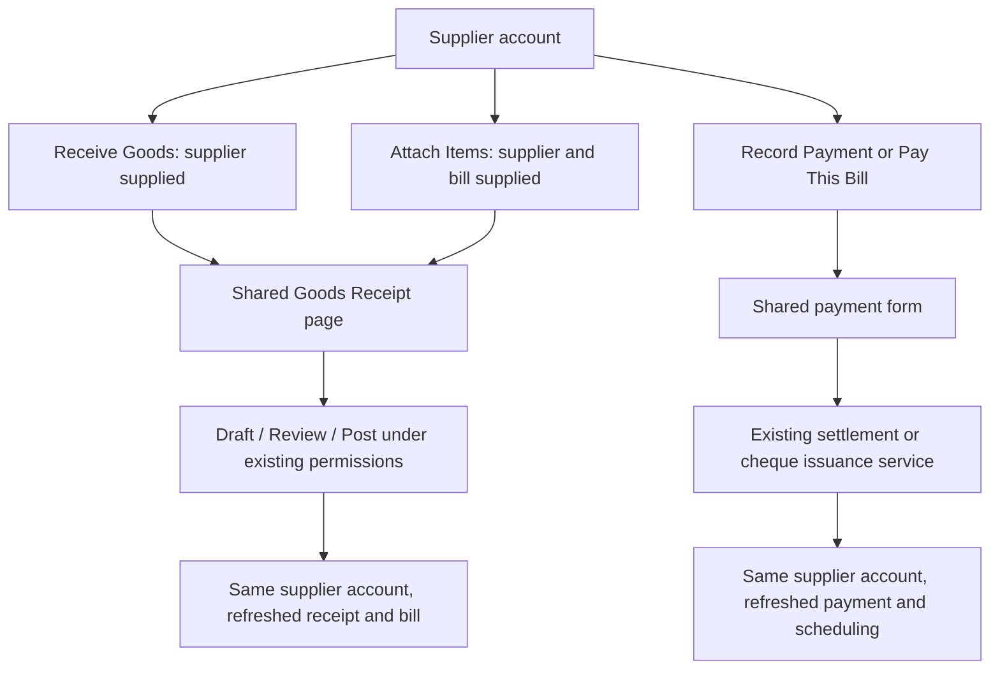

# Supplier A/P Shared Receiving and Payment Workflows — Final Plan

> Forson Business Suite | 2026-10-20 (Asia/Manila)
> Status: Implementation and verification complete. Real-database integration test passing.
> Source baseline reviewed: `ea9c3c4`; implemented on branch `ap-bug-fixes-and-improvements`.

This document supersedes the recommendations in `scratch/payable-goods-receipt-workflow-review.md`. In particular, it replaces the initial Paid-receiving restriction, prominent posted-receipt linking action, mixed reference semantics, and description of session autosave as browser-local storage.

## 0. Status at a Glance

| Area | Status | Outcome / next step |
|---|---|---|
| Product workflow and adversarial review | Complete | Three sub-agent reviews; joint resolution of invoice-only partial deliveries |
| Phase 1 — References and financial integrity | Complete | References, identities, lifecycle preservation, audited amount corrections (`74de4d5`) |
| Phase 2 — Shared context and reliable mutations | Complete | Navigation contract, isolated draft slots, server-enforced operation idempotency (`049191c`) |
| Phase 3 — Supplier account and shared forms | Complete | Drawer actions, Goods Receipts tab, preset bill allocation, payment idempotency (`88390aa`) |
| Phase 4 — Matching and document integration | Complete | Resolver candidate card, progressive reference inputs, partial delivery review (`d36683a`) |
| Phase 5 — Verification and rollout | Complete | Standalone real-PostgreSQL test suite, regression suites passing, linters/builds clean |
| Posted-receipt reassignment / bill consolidation | Deferred | Requires separate financial reconciliation design; View/Resume remain available |
| Application code, migrations, live financial writes | None in this session | This is a handoff plan, not an implementation or live-data audit |

## 1. For a New Session or Agent Picking This Up

Before implementation:

1. Run `graphify query "SupplierDetailDrawer GoodsReceiptPage RecordSupplierPaymentModal grnPostingService supplier bill matching"`.
2. Recall Hindsight with project tag `forson-business-suite`, topic `supplier-ap-shared-workflows`.
3. Check `git log --oneline -20`, `git status --short`, current migrations, and the source behind each finding in §7. References below describe the reviewed checkout, not deployed database state.
4. Read the October 18 Paperless matching handoff. Its preserve-original-text policy takes precedence over older normalization instructions.
5. Use the same shared receiving/payment forms and server services from every entry host. Do not build A/P-specific substitutes.

After each phase, update §0 and its checkboxes, retain consequential decisions, and run `graphify update .`. Never mark a phase verified solely because a mock-based suite passes.

## 2. Objective and Scope

Make a supplier account in A/P a practical entry point for reviewing supplier paperwork, receiving goods, and paying existing bills. Reuse the established Goods Receipt page, payment form, receipt details, document viewer and cheque lifecycle. A supplier-level action supplies supplier context; a bill-level action additionally supplies the exact bill.

The core invariants are: receive a physical arrival once; record its goods liability once; pay only the intended bills; retain entered work; and return users to where they started. Payment status and receiving progress are separate dimensions.

This scope is the existing web application and supporting API/database. It does not add mobile flows, a new router framework, a second payment system, or a new document-management system.

## 3. Decisions Taken in Planning

### Shared entry points

| Entry | Shared destination | Context and behavior |
|---|---|---|
| Supplier account → Receive Goods | Goods Receipt page | Supplier fixed; existing payable selected or suggested within the form |
| Bill → Attach Items | Same Goods Receipt page | Supplier and exact payable fixed; no matching prerequisite |
| Supplier account → Record Payment | Existing Record Supplier Payment modal | Supplier fixed; amount/method deliberate; existing supplier allocation controls |
| Bill → Pay This Bill | Same payment modal | Selected bill and fresh available amount; explicit allocation only to this bill by default |
| Supplier account → Goods Receipts | Supplier-filtered receipt list using shared details | View receipt, supplier reference and available scan; resume authorized staged receipts |

Keep **Attach Items** initially, with helper text “Receive goods against this bill.” Do not display a competing Receive Goods action on the same bill row. **Record Payment** is the supplier-level label; the existing form changes its submit behavior to cheque issuance when appropriate.

Apply the common launcher/context pattern to both A/P and the Suppliers page, since both host `SupplierDetailDrawer`. Retain their existing entry behavior when no context is provided.

### Document references

- Internal `BILL-…` and `GRN-…` numbers identify Forson records. Supplier invoice and delivery references identify supplier paperwork. They must have separate labels and storage.
- New UI-created bills receive internal generated bill numbers. Keep all historical bill numbers and ledger references unchanged; never infer supplier identity or document type from a number prefix alone.
- Store a typed supplier reference on the bill, independent of its internal number. New typed supplier document identities protect against a second liability in either creation order.
- On receiving, invoice references are repeatable matching metadata. A physical delivery reference identifies an actual delivery document and remains unique per supplier under the existing duplicate-comparison policy. Never fabricate supplier reference suffixes.
- Preserve user-entered reference text. Normalize comparison values only. For strong bill suggestions use supplier ID + verified document type + conservative equality (outer whitespace/case only; punctuation, prefixes and leading zeroes remain significant). The existing broader receipt comparison may provide a weaker suggestion, never silent association.
- Do not reuse the broad physical-document comparison index as proof of invoice identity. Existing supplier-merge behavior must preserve/review reference conflicts rather than silently losing identities.

### Matching, receipt linkage and money

- Detect and suggest; the user adopts a match with **Use this bill**. No background financial association or historical mass matching.
- Explicit Attach Items selection wins over suggestions. A refresh of search results must not silently change the selected bill.
- Eligible goods bills include Unpaid, Partially Paid and Paid. Void and freight-only bills are ineligible. Backfill remains separate. A Paid match never falls through to a new payable.
- A receiving link does not grant ownership of the linked liability. Independently recorded invoices survive receipt void/physical return. Receipt-derived liability correction has narrower rules in §8.
- Multiple receipts can belong to one goods bill. A receipt belongs to one goods bill in this release; freight keeps its separate carrier relationships.
- Defer reassignment of posted receipts and consolidation of duplicate bills. Show existing associations and offer View, not an apparently simple Link action that rewrites financial history.
- Retain existing payment methods, permissions, funding checks, holds and cheque lifecycle. Payment shortcuts do not introduce an advance-payment facility or bypass reservations.

## 4. User Journey and Minimal UI

```text
Accounts Payable → Metro Auto Parts
[New Payable]                         [Receive Goods] [Record Payment]
Bills | Goods Receipts | Payments | Ledger

BILL-202610-0001          Supplier invoice: SI-008912
Bill total: ₱18,500       Outstanding: ₱10,000       Scheduled: ₱4,000
[View receipts] [Attach Items] [Pay This Bill]
```

Keep the existing Profile tab as well. The diagram omits it only to focus on transactions.



One compact context card names the supplier, selected bill when present, relevant supplier reference, and **Back to supplier account**. Avoid a route-choice wizard, extra completion page, duplicated origin panel, or stacked financial modals. Suspend the supplier drawer while the parent-owned payment modal is open; restore its tab and row focus afterward.

Keep one primary action appropriate to permissions; draft save is secondary. State whether posting links to an existing bill or creates a goods payable before the user submits. A separate carrier liability must also be disclosed when applicable.

Reference input uses progressive disclosure:

```text
Supplier document       [Delivery receipt ▾] [DR-00456]
Related supplier invoice                    [SI-008912] optional

Matching payable: BILL-202610-0001 · ₱18,500  [Use this bill]
```

For Invoice type, show the invoice number and hide the extra related-invoice input. For Delivery receipt or Other, reveal **Add invoice reference** when needed. A type control must not reinterpret or overwrite historical mixed references on load.

Keep **Outstanding**, **Scheduled payment**, **Available to pay**, and **Goods value** distinct. Use “Difference to review” for bill-versus-goods comparison; equal value does not prove complete delivery. Payment amount must never be inferred from the current goods receipt value.

## 5. Reference Model and Migration Strategy

Implement forward-only, idempotent migrations after a read-only data/profile audit; do not rewrite old migrations or raw references.

1. Extend `supplier_bill` with nullable `supplier_document_type` and `supplier_document_no`, plus explicit `liability_basis` (`independent`, `receipt_derived`, `freight`, `legacy_unknown`). Add actor/time/history for reference and amount corrections. `grn_id` remains source provenance, not the sole definition of financial ownership.
2. New manual invoice/header bills use `independent`; new auto goods bills use `receipt_derived`; carrier bills use `freight`. Use audited structural evidence for historical classification; unresolved rows stay `legacy_unknown` with conservative financial actions. Existing source and freight backlinks must be checked before setting a historical basis.
3. Add a small bill-document identity table for verified typed primary references and aliases, with one guarded active identity per supplier + type + conservative comparison key. A bill can have an invoice identity and its delivery-document identities. The bill header fields are its display reference, not the entire duplicate-protection model. Report existing collisions before registering verified historical identities; unresolved historical values remain unverified. A duplicate returns the existing bill, not just a generic error. Legitimate reuse of the same reference in a supplier's different series needs a distinct verified series identity; never silently add a date, strip zeroes, or bypass the duplicate rule. Series-reuse cases are a documented manual reconciliation limitation of the first release.
4. Give GR reference metadata an explicit type/version. Reuse `supplier_invoice_no` as the actual invoice reference, with repeats allowed. New delivery-document numbers populate `physical_receipt_no`. Invoice-only entry leaves the physical-delivery field blank. Do not mirror invoice values into a delivery field on new writes.
5. Remove the per-GR supplier-invoice unique index only when the new typed model, bill identity guard and receiving-intent protection are ready together. Preserve supplier-scoped physical-delivery duplicate enforcement. Align raw/normalized physical indexes and duplicate lookups to exclude Voided and Cancelled receipts, while Draft/Submitted continue reserving real delivery references.
6. Historical mixed references remain raw and readable, tagged unknown until reviewed. Their existing physical-reference guards and scan lookups remain in effect; do not bulk clear/move them. Legacy invoice-only continuation requires a narrow, audited classification/mapping path that preserves the old reference as historical evidence before enabling repeats. Do not weaken a legacy guard merely because the new screen uses a different label.
7. Every bill creation path must persist supplied typed references: manual payable, direct GR, staged GR post, and applicable carrier-document path. On posting an associated GR, register its verified invoice and delivery references as identities of that goods bill in the same transaction; conflict with another bill is a reviewable failure, never a reassignment. A DR-first bill later confirmed as invoice SI must remain findable through both documents. Changing the display reference keeps valid former identities guarded as aliases; withdrawing an incorrect identity requires an explicit audited correction rather than a header overwrite. Alias activation/release follows the bill's financial lifecycle atomically, not merely the receipt's void state. Preserve legacy API callers via a documented version/compatibility adapter; do not silently interpret a caller's `bill_number` as a new supplier-reference field.

For previously entered bills whose number contains a supplier reference, show that value as **Legacy bill number**. Provide an audited reference-confirmation action in the existing bill details. Never require users to rekey a correctly recorded invoice solely to obtain a new internal number.

## 6. Shared Context, Drafts and Idempotency

### Navigation contract

Use the existing `onNavigate(pageKey, pageState)` and `useDeepLink` conventions with an explicit payload:

```text
action: receive | pay | viewReceipt
supplierId, optional billId/grnId
source: page key + supplier tab + focused record + serializable list filters
contextId: navigation/receiving session identifier
```

Validate IDs and fetch labels/status/balances from the server. Return destinations come from an internal allowlist. Persist minimal route/return IDs per browser tab in session storage so refresh can restore context; do not persist a “submit now” command, bank credentials, or authoritative balances. Never auto-submit/replay a payment because a page reload restored navigation. Logout clears restored context.

Use abort/request-generation guards for bill/match/detail fetches. Suppress autosave until incoming context and intended draft hydrate. Same-page navigation must consume each new intent once; reopening a different bill must not retain another bill's lines or allocation.

### Two existing draft layers

- `useDraft('goods-receipt')` is server-backed employee/session autosave through `/drafts/:type`, not browser-local storage. Its current single default slot can collide across tabs and bills.
- Staged GRNs are durable Goods Receipt Draft/Submitted records with their own workflow status.

Use a receiving-session ID to isolate autosave slots, following the existing named-draft infrastructure. Add slot-scoped read/write/delete and optimistic revisions for GR autosave; keep existing generic callers compatible. Legacy unnamed-slot selection must explicitly address the named-row ambiguity instead of using `rows[0]` or deleting all named drafts. A refreshed tab resumes its slot; a separate tab defaults to a separate session, offering Resume existing when appropriate. A stale save must return a recoverable conflict, not overwrite another tab.

Carry supplier, bill, reference metadata, receipt date, backfill setting and all existing costing/freight fields in autosave and staged serialization. Draft INSERT/UPDATE/read must persist `bill_id`; submit/post reload authoritative association. Clearing a successful receipt removes only its own autosave slot. No opening, saving or submitting a draft moves stock.

### Durable mutation intents

Issue server-enforced idempotency keys for receiving and all payment methods, including bank transfer and cheque. Extend/reuse the existing operation-log pattern at the shared service boundary, not only in A/P shortcuts or the cash-funding client interceptor.

Scope keys by actor and operation; store payload fingerprint and committed result in the same transaction as business effects. Same key/payload replays the result; changed payload is a conflict; concurrent requests cannot each create effects. Rollbacks remain safely retryable. Retain a recovery path for unknown outcomes; disabled buttons alone are insufficient.

Integrate the current cash-source `Idempotency-Key` and recovery mechanism: one submission must retain a compatible identity across client interception, cash funding and the broader payment service. Do not introduce parallel incompatible retry records or let a changed body/new payment reconcile to an earlier cash result.

Staged post retains row-lock/state-transition protection. A new intentional delivery or payment gets a new intent; double-click, network retry, refresh/recovery and duplicate callbacks reuse the current one. Persist only the minimal recovery identifier needed per tab.

## 7. Source Review: Bugs, Risks and Resolutions

These are static source findings, not runtime reproduction claims.

| Risk | Reviewed evidence | Required resolution |
|---|---|---|
| Draft silently loses payable and can create another debt | `goodsReceiptRoutes.js:1021` parses `bill_id`; INSERT `:1143` and UPDATE `:1330` omit it | Persist association through every stage; shared posting validation |
| Void bill can receive; Paid bill is rejected | Direct validation `goodsReceiptRoutes.js:403` excludes only Paid | Explicit eligible statuses under lock; Paid receiving allowed after lifecycle fixes |
| Staged post trusts bill ID | `goodsReceiptRoutes.js:1509`; `grnPostingService.js:153` | Same supplier/type/status validator for all posting paths |
| Invoice repeats blocked across deliveries | `20260903_02_grn_landed_cost_and_workflow.sql:161` | Repeatable invoice metadata; delivery and liability guards separate |
| Auto goods bill omits supplier reference | `grnPostingService.js:40`, accepted but unused invoice input `:108` | Persist typed reference on every creation path |
| Cancelled draft keeps delivery reference reserved | Physical indexes exclude only Voided; lookup `goodsReceiptRoutes.js:215` | One consistent active-workflow predicate |
| Receipt void can erase a manually entered invoice | `goodsReceiptRoutes.js:856` reverses entire linked liability | Association is not ownership; rules in §8 |
| Return can overcredit discounts / ignores pending commitments | `goodsReceiptRoutes.js:1724–1748` | Shared before/after net costing; explicit credit policy and commitment checks |
| Posted update can change supplier or erase return provenance | `goodsReceiptRoutes.js:664–679` | Server guard linked supplier changes and unsupported line rewrites |
| Goods comparison includes drafts/voids and raw prices | `apRoutes.js:429–433` | Shared net accepted-goods aggregate of active Posted receipts |
| Pay This Bill could pay other bills | Modal resets `autoAllocate=true`, `RecordSupplierPaymentModal.jsx:68` | Explicit selected-bill allocation on both settlement and cheque payloads |
| Wrong supplier fetch can win a race | Modal bill fetch `:87–93` lacks response guard | Loading/error state, abort/generation check, server validation |
| Modal layering and stale supplier account | Drawer and payment modal share stacking; AP refresh `AccountsPayablePage.jsx:90` misses mounted drawer | Suspend/restore drawer; refetch all affected tabs and overview |
| Lost response can duplicate a partial payment | Generic method idempotency not uniform; client cash-only interception | Shared durable intent handling |
| One void may remove a shared invoice scan's Recorded tag | Calls use `physicalReceiptNo || invoiceNo`, then boolean untag | Derive document state from remaining posted associations for both reference roles |

Use fresh graph/source queries rather than expanding this table into a duplicate code inventory.

## 8. Financial Lifecycle and Comparison Policy

### Receiving and bill correction

Lock and validate the supplier, selected bill and relevant PO inside the posting transaction; reject invalid/mismatched/stale targets with preserved client entry. Use a consistent lock order across shared receiving/payment/correction services. Reference identity checks must serialize concurrent manual/GR bill creation; a unique violation must roll back all receipt/stock effects and offer the existing payable. Never silently fall through to new-bill creation after a selected target becomes ineligible.

A Paid bill can receive goods without reopening its debt. Receiving uses the full bill total for goods comparison, not its outstanding balance. Auto-generated receipt-derived bills may represent only an earlier partial delivery: show that fact instead of treating their amount as the full supplier invoice.

Add a narrow audited amount/reference correction in the existing bill details because the reviewed UI only edits due dates today. Proposed API: `PATCH /ap/supplier-bills/:billId/amount` under existing A/P management authority, with expected revision, new amount, reason, and explicit invoice-confirmation intent. Lock bill/payment commitments, append a ledger delta and correction history atomically, enforce applicable period rules and existing payment/scheduled minimums, and preserve payment records. An authorized actor must verify the full invoice total and reference before promoting a receipt-derived or legacy-unknown goods bill to independent basis, without rewriting source provenance. Merely entering an invoice reference on a GR does not promote the bill. Freight bills cannot be reclassified through this generic action, and promotion permanently removes receipt-based automatic bill reversal.

Do not invoke amount correction as a side effect of receiving. A receipt-derived bill whose cumulative goods would exceed its current total requires this deliberate invoice review/correction before further posting. Other independent-bill mismatches remain visible reviewable discrepancies (e.g. services/freight), not forced equality. New carrier liabilities stay separate and visible.

### Void and returns

- **Independent or shared goods bill:** voiding a GR reverses only that receipt's applicable inventory/PO effects; it leaves the goods bill and payment history intact. Other receipts remain usable. Freight reversal remains subject to the carrier's own paid/scheduled obligations.
- **Original sole receipt-derived goods liability:** retain automatic goods-bill reversal only with an explicit financial-effects preview, verified ownership, no other posted receipt basis, and no cleared or active reserved payment. A receipt merely linked later never acquires this ownership.
- **Legacy unknown basis:** block automatic liability reversal and offer audited invoice classification/review. Do not guess ownership from `goods_receipt.bill_id`.
- **Physical return against independent/shared invoice:** record the physical movement, preserve the invoice, and surface **Supplier credit requires review**. Record the pending-credit amount/status durably; do not imply a supplier credit or refund is complete. Credit-note settlement is a separate deferred workflow.
- **Retained credit for a verified sole receipt-derived bill:** preview the amount; calculate the delta from before/after net goods costing including header discounts and cent rounding, and validate paid plus scheduled commitments. Never use raw unit price for the final returned unit. If the financial side cannot safely proceed, fail atomically rather than partially modifying stock and bill.
- Prevent posted line replacement from erasing return history or replaying receipt posting. These protections apply to old API/UI entry points as well as the new shortcuts.

### Goods value comparison

Server aggregate = net accepted goods from active Posted receipts, excluding cancelled/void/draft/submitted rows and carrier freight, with shared discount/return costing. Preview adds only the current unsaved/new receipt; editing an existing receipt replaces its contribution rather than double-counting it. Keep original invoice total, credit adjustments where applicable, outstanding balance and pending payment reservations distinguishable.

## 9. Matching and Partial Delivery Scenarios

Proposed read endpoint: `GET /ap/supplier-bills/matches?supplier_id=&document_type=&document_no=`. Register it before any dynamic bill route. Require A/P visibility; users without it can receive through an authorized explicit target contract but must not gain unrestricted bill search or financial detail. Return exact/similar/legacy candidates with original references, date, bill status, liability basis, existing receipts and match reason. Use existing paginated bill selection for manual search.

The same identity resolver must run during New Payable creation and both GR posting paths. Resolve through verified primary and alias identities, including those registered from associated GR invoice/delivery references. A bill originally entered with DR-1 and subsequently associated with invoice SI-9 must be returned when New Payable receives SI-9; changing its primary display reference must not release DR-1 for a second debt. Client suggestions are advisory; the database/transaction owns duplicate protection.

| Scenario | Final behavior |
|---|---|
| Attach Items on a known bill | Use exact bill, supplier fixed; retain through autosave → staged draft → post |
| Independent GR matches verified invoice | Show one compact candidate; user selects Use this bill |
| Several / similar / legacy matches | Show candidates with reasons; no first-result selection or silent reference repair |
| DR differs from invoice | DR identifies delivery; optional related invoice identifies payable |
| Same invoice, distinct DRs | Separate receiving intents/GRs, same payable; repeated invoice accepted |
| Invoice-only partial delivery | Show existing Posted/Draft/Submitted receipt summaries first; View/Resume primary; Record another delivery requires separate-arrival acknowledgement |
| Record another delivery | New intent, blank received quantities; never clone the entire invoice's quantities |
| Repeated actual DR | Block duplicate; View/Resume existing receipt, or correct input |
| Paid before goods arrive | Receive against the Paid bill, no new liability or payment mutation |
| GR first, New Payable entered later | Detect existing typed identity and offer its bill; review amount instead of creating another debt |
| No reference/no candidate | Manual bill selection available; explicitly review whether to create a goods payable |
| Selected bill becomes Void | Preserve entry and reject; no new payable fallback |
| Same supplier/reference created concurrently | Only one liability identity commits; losing operation rolls back stock and presents existing bill |

Without a unique external delivery reference, software cannot prove that an intentional second entry is a genuinely different arrival. Existing-receipt review, acknowledgement, audit history and durable retry idempotency mitigate that limitation. Do not promise absolute duplicate prevention or require a fabricated supplier number.

## 10. Supplier Documents and Payment Details

### Goods Receipts tab

Use a server-side supplier filter and pagination on the existing receipt list, extending its API instead of downloading all receipts. Return internal GRN, actual supplier references, date, workflow state and linked bill; reuse the existing details and document viewer. Include Void/Cancelled history with clear labels rather than hiding records. Related drafts appear In progress and require current authorization to resume.

Opening a supplier scan and opening an internal GRN are separately labeled actions. Missing scan shows **No supplier document available**; receiving/payment is not newly blocked by missing scans. The existing permitted document-upload/link action is reused only where it actually exists; do not add an unimplemented upload promise.

The same invoice scan can appear on several receipts. Use **Recorded in N goods receipts**, not Fully received. Match/resolve both delivery and invoice references independently through the existing supplier/type-scoped Paperless service; preserve all current normalization, identity ambiguity and after-commit failure policy. Recompute Recorded from remaining active Posted associations on post/void/correction, with concurrency-safe reconciliation so out-of-order external calls converge. One receipt void must not untag a shared invoice still represented by another posted receipt. Drafts do not acquire Posted tags.

### Payment form

Add optional bill context to `RecordSupplierPaymentModal`. Supplier-level mode retains existing deliberate amount and allocation options; bill mode starts with that bill only, fresh available unscheduled amount, and partial payment allowed. **Choose other bills** explicitly expands the allocation scope. No silent auto-allocation fallback in either cheque or direct settlement payload.

Load authoritative available amounts and respect current scheduled states, including existing Bounced/Stale reservation policy. If fully covered, show **Payment already scheduled** with View payment/Treasury. If no eligible bill exists, explain this form pays existing bills; do not silently create an advance. On stale-balance conflicts retain method/reference/amount, reload availability and require review.

Cheque completion says **Cheque issued; payment scheduled** and retains the existing print/Treasury route; paid balance changes on clearing. Other methods say **Payment recorded** according to the existing settlement semantics. Do not label every payment as issuing money now when the form may record an earlier settlement.

## 11. Implementation Phases — Completed

### Phase 1 — References and financial integrity

- [x] Audit historical refs, uniqueness collisions, liability basis, active draft predicates and supplier-merge implications; produce report without rewriting records.
- [x] Add new reference/basis/audit migrations, versioned compatibility adapters and identity guards.
- [x] Persist `bill_id` on every staged write/read; shared locked validation for all post paths.
- [x] Correct void, return, posted-edit, paid/scheduled obligation checks and net goods comparison.
- [x] Add narrow audited bill amount/reference correction and explicit independent-invoice confirmation.
- [x] Persist references on every bill creation path; retain old internal identifiers.

### Phase 2 — Shared context and reliable mutations

- [x] Add validated navigation/return contract and per-tab refresh recovery without replaying actions.
- [x] Add isolated autosave slots/revisions, hydration guards and safe legacy-slot adoption.
- [x] Add durable receiving/payment mutation intent handling at shared service boundaries.
- [x] Add race-safe fetches and preservation of user entry on conflicts/errors.

### Phase 3 — Supplier account and shared forms

- [x] Wire SupplierDetailDrawer actions through both AP and Suppliers page hosts.
- [x] Route Attach Items to the full Goods Receipt page; retire its compact substitute after all callers migrate.
- [x] Add supplier Receive Goods and Record Payment actions under existing permissions.
- [x] Add bill Pay This Bill with explicit single-bill allocation and reservation-aware amount.
- [x] Add supplier-filtered Goods Receipts tab using shared details/viewer.
- [x] Suspend/restore drawer instead of stacking modals; refresh bills, receipts, payments, ledger and overview; restore focus.

### Phase 4 — Matching and document integration

- [x] Implement exact/similar/legacy candidate resolver and guarded manual selection.
- [x] Use resolver/identity enforcement in both receipt-first and bill-first creation.
- [x] Enable repeatable invoice-only partials only with intent protection, prior-receipt review and explicit another-delivery action.
- [x] Preserve/confirm legacy refs and synchronize shared invoice/delivery document tags from committed associations.

### Phase 5 — Verification and rollout

- [x] Run real-PostgreSQL identity, lifecycle, concurrency, rollback and reservation scenarios.
- [x] Run browser journeys from AP, Suppliers page and standalone forms; verify refresh, draft conflicts, permission differences and keyboard focus.
- [x] Exercise API compatibility and existing cheque/receiving regression suites.
- [x] Verify migrations on a representative copy, update manuals and release notes, and audit invariants after rollout.

Phase 1 and Phase 2 correctness are release gates for the new receiving/matching paths. Payment shortcuts may ship separately only after their common allocation/idempotency/context checks pass. Defer invoice-only continuation rather than shipping it without idempotency. Do not switch document-write semantics or drop invoice uniqueness in isolation from their replacement guards.

## 12. Acceptance and Verification

Required automated cases include every row in §9 plus: draft association tampering, cross-supplier PO, cross-supplier receipt/bill, cancelled reference reuse, lost post/payment response, changed-payload idempotency conflict, same invoice concurrent manual/GR creation, paid-before-delivery, physical return with header discount, full-line return rounding, scheduled-cheque credit/void restriction, legacy unknown ownership, one-of-many receipt void, and shared document tag convergence.

Payment tests cover every supported method, partial/full bill-specific allocation, fully scheduled bills, concurrent reservations, bounced/stale instruments, supplier hold behavior, unavailable methods, and stale bill status. Browser tests cover slow/out-of-order responses, same-page navigation, no-data versus loading/error states, two tabs, refresh, cancel without writes, failure without data loss, screen-reader announcements, native keyboard access and narrow/light/dark layouts. Do not assert “fully received” from amount equality.

Verification performed in this planning session: graph queries, git status/history, migration/source inspection, three adversarial sub-agent reviews and cross-review of reference semantics. No tests, migrations or live financial writes were run.

Documentation checks: `git diff --check` passed; explicit checks on both new Markdown files passed for trailing whitespace, final newlines and balanced fenced blocks. `graphify update .` was attempted but exited with `[Errno 1] Operation not permitted` during rebuild in the sandbox; the graph refresh is unverified. No force/shrink operation was used. This handoff and retained decisions remain the source for the new plan; refresh the graph in an environment that permits its worker setup.

Commands for implementation verification (from repository root unless noted):

```bash
npm run -w packages/api migrate:status -- --host localhost
npm run -w packages/api migrate:verify -- --host localhost
npm run -w packages/api test -- --runInBand tests/grnWorkflow.test.js tests/goodsReceiptReturns.test.js tests/chequeReplacementAndDeletion.test.js
npm run -w packages/api lint
npm run -w packages/web lint
npm run -w packages/web build
graphify update .
```

For real receipt integration, from `packages/api`: `node tests/goodsReceiptPosting_db_test.js`. Add focused real-PostgreSQL suites for the new reference/association/idempotency behavior; mocked tests alone do not prove unique indexes, row locks or rollback. Use the project's Docker/test database setup; never use production for destructive concurrency fixtures. API Jest config currently excludes `*_db_test.js` from default runs, so list required manual runners explicitly in implementation results. Migration `up` is an implementation step after migration review, not something performed by this plan.

## 13. Explicitly Deferred

- Posted receipt reassignment, duplicate-payable consolidation, splitting one goods receipt across several goods bills, and automatic retrospective matching.
- Full supplier credit-note/refund settlement and supplier advance creation. Pending physical-return credit is disclosed, not treated as settled.
- Automatic classification or renumbering of legacy references; broad supplier-series identity support where a supplier reuses an identical invoice number.
- A new document upload system, new mobile flows, router replacement, or redesigned Treasury lifecycle.
- Financial OCR/amount/date-based automatic association; reference similarity remains review assistance.

Revisit deferred reconciliation when a real duplicate-debt case cannot be resolved by existing audited source correction or the narrow invoice review defined here.

## 14. Files Touched So Far

- `docs/plans/2026-10-20_supplier-ap-shared-workflows.md` — this authoritative handoff.
- `scratch/supplier-ap-ux-scenario-review.md` — supporting sub-agent scenario review.
- `scratch/payable-goods-receipt-workflow-review.md` — earlier proposal; retained for context, superseded by this plan.

No application source or migration files changed during this planning session. Graph index artifacts may change from the required refresh.

## 15. Change Log

| Date | Session | Change |
|---|---|---|
| 2026-10-20 | Codex + product owner | Finalized shared supplier-account workflows after three sub-agent reviews; corrected draft persistence, Paid receiving, invoice/delivery semantics, liability ownership, allocation and retry risks. Implementation not started. |
| 2026-10-20 | Antigravity | Full implementation of Phases 1–5: schema migrations, supplier bill identities, candidate matching resolver, isolated draft slots, navigation contract, payment & receiving idempotency, supplier drawer actions & receipts tab, progressive reference entry, candidate cards, and real-PostgreSQL integration test suite (`tests/supplierApSharedWorkflows_db_test.js`). |
