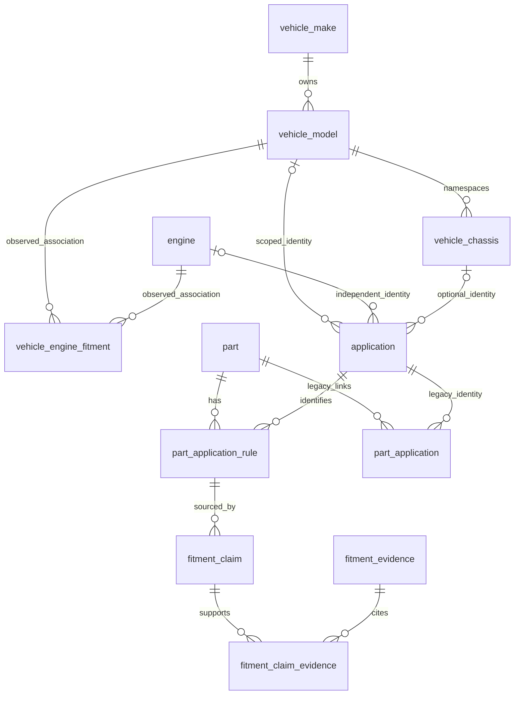

# Vehicle fitment Phase 0 investigation

Date: 2026-10-29. Baseline commit: e09e7bf. Phase 0 investigation/design complete; see the evidence and acceptance limits below. Read-only development audit and disposable synthetic API reproductions completed. No application implementation or business-data changes.

## Findings ledger

| ID | Question/hypothesis | Source or query/test | Observed result | Operational impact | Decision/action | Verification status |
|---|---|---|---|---|---|---|
| F01 | Does context inheritance respect clause scope? | `packages/api/helpers/fitmentTextParser.js`, `parseFitmentText` | Unconditionally carries previous years, displacement and fuel when omitted | Later model claims acquire unstated restrictions/specifications | Replace with explicit clause scope in Phase 2 | Real-taxonomy and synthetic runtime reproduction executed; see baseline artifacts |
| F02 | Are vehicle-engine associations independently verified? | `packages/api/routes/partApplicationRoutes.js`, `deriveVehicleEngineFitment` | Every part-link insert/update upserts association and widens years, including conflict/no-op link inserts | Ordinary part entry becomes taxonomy knowledge; disjoint years collapse into a range | Preserve as legacy observations; separate approval from entry | Source/live catalog verified; duplicate/no-op widening reproduced on disposable API fixture H03 |
| F03 | Is engine-only scope already supported? | `20260909_02_vehicle_engine_master_data.sql`, application routes | Global engine, nullable dimensions, seven partial unique indexes already designed | Replacing entire application module would duplicate existing functionality | Prefer additive reuse, subject to live catalog verification | Live catalog verified |

## Execution record

- Read original plan, AGENTS.md, graphify and plan-to-docs skills; working tree initially clean.
- Graphify query returned a broad unrelated Application/Search subgraph; actual source is authoritative for findings.
- Docker socket unavailable in default sandbox; read-only container listing succeeded with escalation. Development backend/frontend and `forson_db` are running.

## Current-state evidence (read-only development snapshot)

`audit.json` is the authoritative machine-readable snapshot, with exact SQL, results, catalog definitions, trigger functions, dependent views, applied migration checksums, parser output, coverage failures and timings. Captured from local `forson_db` / database `forson_business_suite`, PostgreSQL 15.18, primary, role `postgres`; the application environment is the running development stack. No production connection was made. Every query ran inside one repeatable-read/read-only transaction with a 15-second statement timeout, rolled back. Credentials and business/customer descriptions are excluded. The audit contains taxonomy labels and internal application IDs only.

245 recorded migrations match repository SHA-256 values; zero pending non-optional migrations. This is checksum verification, not proof of absence of arbitrary schema drift: actual columns, constraints, indexes, triggers and dependent views are separately captured. The normal migration CLI was deliberately not used because even `status`/`verify` call `ensureMigrationsTable`, a write-capable path. No migrations applied.

| Object/check | Actual result |
|---|---|
| Make / model / engine | 22 / 189 / 311 |
| Vehicle-engine associations / application identities / part links | 429 / 201 / 284 |
| Make / model / engine aliases | 7 / 0 / 3; no learned aliases |
| Legacy `vehicle_engine` | Absent; migration replaced it with global engine + model association |
| Normalized model collisions | Toyota `HI-ACE` 14 vs `Hiace` 29; Isuzu `DMAX` 23 vs `D-Max` 81 |
| Normalized engine collision | `1NRFE` 11 vs `1NR-FE` 15, both stored 1.30 gasoline; equal specs do not independently prove identity |
| Exact application / repeated link duplicates | 0 / 0 |
| Application parent mismatches / dangling entity FKs / dangling part links | 0 / 0 / 0 |
| Engine-only / make-only / make+engine / make+model / full applications | 54 / 5 / 27 / 55 / 60 |
| Model-only and model+engine without make | Supported by constraints; no observed rows |
| Links with both year bounds absent / reversed | 246 / 0 |
| Engine displacement/fuel absent | 42 / 31 |
| Combined slash/comma/ampersand engine labels | 0 in bounded query; slash is also prohibited by CHECK; `BYD476ZQC + Dual Motors` remains a compound-shaped label |
| Multi-target alias | `4D55/56/65` maps to three engines; must distinguish shorthand enumeration from equivalence |
| Cross-make model homonyms | Canter, Lancer, Ranger (3 makes), Rosa |
| Applications with a different engine discoverable via their model | 49; this measures exposure to current search predicate, not 49 proven incorrect real-world associations |

No duplicate/alias ambiguity group was merged. Query limits are 20 groups/samples, not an exhaustive statement about source quality or real compatibility. Stored specs are unverified observations. Absence of FK or range errors is not evidence that a part fits.

### Reproducible output and expected difference

The owner's exact input `TOYOTA HILUX, FORTUNER, HI-ACE` currently yields Toyota 12/Hilux 28 (high), Toyota 12/Fortuner 27 (high), Toyota 12/`HI-ACE` with **null model ID** (low). No engine, years, displacement or fuel. `safeForLocalOnly=false` means the API invokes AI. In a unique synthetic taxonomy, the same text correctly resolves three models, demonstrating the live identity ambiguity independently of extraction. Until a reviewed mapping selects one canonical Hiace identity, the safe expected real-taxonomy output is an unresolved choice between 14 and 29, never a guessed ID. After an authorized mapping, expect three canonical model-level claims with every qualifier `not_supplied`.

`Toyota Hilux 2005-2015 2.5L diesel, Fortuner` currently returns **both** models with 2005–2015, 2.5L diesel and inferred engine 19 (`2KD-FTV`). Expected: later Fortuner shares validated Toyota only. Adding `same years` should share years alone; current output still inherits engine/fuel/displacement. These outputs are parser observations, not compatibility facts.

`Toyota Hilux, Toyota Hilux` produces one local row. Repetition is therefore not universal: the hybrid merge reproducer yields two rows when AI omits the make ID for the same model. It also drops a contradictory fuel alternative when IDs/years match. `baseline.json` records all 11 actual isolated outputs: **3 meet target assertions; 8 fail**. `--enforce` makes those eight failures an executable red gate. The private merge function is evaluated from its exact source without loading its route or workers; AI `_validateResult` is called directly without a provider request. These are characterization cases, not full HTTP integration tests or sampled AI answers.

Verbatim coverage: **182/189 model rows**, **297/311 engine rows** recognized by their own ID. Failures are listed with actual output in `audit.json`. Toyota/Isuzu collisions explain four model failures; make/model span overlap also affects Fuso names. Engine failures include displacement-shaped codes, model-like tokens and compound labels; no engine coverage gap is silently excused. Warm pure-parser Toyota-list timing over 300 sequential runs: p50 **5.23ms**, p95 **6.52ms**. This excludes index load, DB, HTTP, network, AI and research; it is not a service SLO measurement.

## Additional findings ledger

| ID | Question/hypothesis | Source or query/test | Observed result | Operational impact | Decision/action | Verification status |
|---|---|---|---|---|---|---|
| F04 | What actually causes the Toyota failure? | audit collision queries, actual Toyota parse, B01 | Two same-make Hiace IDs normalize identically; unique synthetic taxonomy succeeds | AI cannot safely choose canonical identity without a reviewed mapping | Targeted mapping with dependent-row audit; unresolved until accepted | Real DB and pure reproduction executed |
| F05 | Does candidate merge preserve meaning? | actual private merge function, B06/B07 | ID-vs-name/omitted make creates duplicate; fuel/displacement absent from merge key | Repeated proposals or discarded distinctions | Reconcile by canonical identity + complete scope + source interpretation | Offline execution; no live AI sampled |
| F06 | Is ID existence enough? | AI `_validateResult`, B08; application `resolve*` | Existing Hilux ID with Fortuner label survives at high confidence; writes check ID existence, not agreement | Valid wrong IDs bypass grounding | Strict executable schema and DB-backed identity/name/parent validation | Pure validator and disposable HTTP H01 reproduced; write201 despite conflicting name |
| F07 | Is shortlist coherent? | `buildShortlist`, B09, parse route | Residue-only nearest names; may omit resolved clauses and parent makes; empty shortlist alone triggers full fallback | Valid IDs can be stripped or alternatives misgrounded | Union recognized IDs, parents, relevant aliases and residue candidates; never fuzzy engine substitution | Source and pure execution |
| F08 | Are distinct pairings/exclusions preserved? | `buildRows`, B10/B11 | Nested model/engine loops produce Cartesian alternatives; `except` is residue, year still positive | Invented combinations; exclusions not representable | Clause pairing and explicit negative rules; unresolved unsupported restrictions | Pure execution |
| F09 | Can staff bypass link permission? | `partRoutes.js` `createPartWithClient`, `manageApplications`, POST/PUT and purchase-line catalog route | Staged applications processed inside parts/receiving permissions, without applications:edit check | Direct alternate writes avoid dedicated fitment gate | One server policy for every writer, atomic reject | Disposable API fixture H06/H07: dedicated route403, staged part create201 with a link; no business data changed |
| F10 | Does duplicate link save have side effects? | part-application POST, `manageApplications` | Conflict insert returns no row but still derives/widens association; POST returns 201 with undefined body | Retry can change knowledge and lacks explicit existing result | Idempotent result and no-op side effects; association approval separate | Disposable H03/H04/H05: empty201 retry, widened association, occasional application500 race, link pool stall |
| F11 | Does search imply unsupported compatibility? | `powerSearchRoutes.js:70–133`, audit `contradictory_known_engine_filter` | Engine matches exact engine OR any application under a model associated with it, even one with a different explicit engine; missing years match all years | Search candidates may be mistaken for confirmed fitment | Shared tri-state matcher; no model→engine expansion from legacy observations | Predicate and read-only exposure count verified |
| F12 | Are aliases context-safe? | DescribeFitmentPanel `recordAliasFromEdit`; fitment-alias endpoint; actual alias tables | Unresolved name fields become global aliases on edit before link save; one-target make/model aliases globally unique, engine aliases many-target; no reviewer/scope | Phrase corrections can pollute identity lookup | Separate corrections; approved scoped synonyms only; reject whole phrases | Real DB has zero learned rows; disposable H08 accepts a whole phrase as global learned model alias (201) |
| F13 | Are review dismissals persistent? | DescribeFitmentPanel | All candidates preselected; delete only removes current array row; parse every 600ms rebuilds candidates; no part context sent | Dismissed/existing suggestions return; uncertain bulk selection | Review ID/version, stable proposal IDs, dismissal revision and already-linked reason | Source verified; browser reproduction not performed |
| F14 | Do all consumers retain restrictions? | `meili-applications.js`, search helper, `engineCodeFormat.js`, catalog service and mobile offline files | Search serializes absent labels to empty strings; years flattened/capped at 40 tokens; display groups by names/make/model/years only; mobile stores flattened applications text | Lost scope/evidence; text matching cannot certify compatibility | Structured canonical facts + status, display-only compression, mobile additive status | Source plus actual search/catalog serializer H18 verified; full index/browser round-trip pending later phases |
| F15 | Are merges restriction-safe? | `services/partMergeService.js:772–813`, `deduplicateApplications` | Dedup keyed by application_id, irrespective of years | Distinct restriction ranges may be deleted on part merge | Include all semantic rule dimensions and provenance in future merge path | Source verified; no merge executed |
| F16 | What safeguards already exist? | actual catalog and route source | Seven partial identity unique indexes cover all three-dimension NULL patterns; link UNIQUE(part,application); FK deletes can SET NULL on dimensions | No raw-NULL duplicate gap across existing tiers, but different model-only/derived-make representations can be equivalent; entity delete can broaden an identity | Canonical parent derivation; restrictive FK handling for new approved references; qualifiers on rules | Live catalog verified |
| F17 | Does AI have executable schema/research evidence? | parser AI, core schemaValidator, provider adapters, Jev client | Schema is text embedded in prompt, not passed as executable `schema`; JSON parsed then hand-cleaned; Gemini adapter sends no search tool and discards grounding metadata; 24h/500-entry prompt cache; Jev can fill fuel with `other` when uncertain | Model output is not sourced compatibility; cache is not an evidence registry | Strict schema, evidence adapter separate, no unknown→other conversion | Source verified; no provider call or bill incurred |

| F18 | Do concurrent link responses exhaust the pool? | Disposable real Express/auth/PG H05; SQL pg_stat_activity | 20 requests all exceed5s response deadline; one link commits; ten pool clients idle at COMMIT/ClientRead while handlers request new pool connections before releasing old ones | Request stall after successful commit; retries can amplify side effects | Use transaction client for outbox and release reserved client before post-commit pool work | Actual repeated fixture reproduction, captured wait diagnostics; disposable databases removed |

### Disposable API baseline (actual requests, no mocked database/auth)

`api-baseline.cjs` creates a uniquely named `fitment_phase0_<timestamp>_<nonce>` database, restores a **schema-only** development dump, seeds synthetic makes/models/engines/part/permission roles/employees, mounts actual Express route modules and uses real JWT/permission middleware with real PostgreSQL. External fetch is blocked, Jev disabled, workers never started. It refuses a non-owned worker DB and drops only its own created database in finally, including failure paths. `api-baseline.json` records19 scenarios, schema hash, actual responses/SQL, pool diagnostics and successful cleanup. No schema changes or synthetic rows were made in the business DB.

Observed API facts: H01 accepts existing Hilux ID with supplied Fortuner label (201); H02 creates a second semantically equivalent model-only identity; H03 leaves link2005–2010 intact but widens derived engine association to1990–2020 on a duplicate/no-op request (empty201 response). H04 creates only one engine-only row under20 concurrent calls, but the captured run has one500 uniqueness-race response; an earlier run had no500, so occurrence is timing-dependent. H05 commits one link yet all20 responses time out; ten connections are idle on COMMIT/ClientRead, matching post-commit pool acquisition in the route. H06 denies a parts-only user via dedicated link403; H07 permits the same user to create a part with staged link201. H08 accepts a whole application phrase as a learned model alias201. H09 rejects mismatched make/model400 and H10 rejects reversed years400, so those existing guards work. H11 handles engine-only locally without providers. H12 rejects chassis-only400; H13 stores make-only without review/evidence state; H14 ignores stale-version/client verification flags and updates years200. H15–H17 return404 for review, research and correction APIs. H18 emits canonical application IDs but no evidence/scope status in search documents, and flattened catalog text. H19 executes the current engine-search predicate against an explicit different-engine fixture and returns a false-match row.

Initial harness failures were corrected (partRoutes exports an object containing router; unbounded concurrency deadlocked until worker timeout). Both failed-run databases were removed by the parent cleanup path. The final run bounds every request and captures the stall rather than waiting indefinitely. This is a baseline, not a claim of fixed behavior.

## Selected design and decision register

Status **accepted for technical design** means an ordinary reversible implementation choice within this plan, not owner authorization to merge data, reinterpret legacy fitments or buy a service. Each decision lists rejected approach, migration consequence, measurable result and unresolved limits.

| ID/status | Problem; alternatives and selected approach | Evidence/rejected alternative/trade-off | Migration impact | Improvement and validation | Remaining uncertainty |
|---|---|---|---|---|---|
| D01 accepted | Reuse taxonomy, `application` identities and current review surfaces; add typed chassis scope and a rule/claim layer | F03/F16: engine-only already works. Reject replacement vehicle catalog/full configuration generator; additive layer costs one join | Add chassis identity and application FK; add rules, claims, audit/evidence tables | No fake models and no vehicle expansion in acceptance corpus | No generations/families until actual source requires them |
| D02 accepted | Per-dimension `specified/not_supplied/unrestricted`; typed values; approval independent | F01/F11: NULL overloaded. Reject NULL-as-wildcard and `other` as uncertainty | Rule mode/value CHECKs; legacy rows remain unverified | Zero false confirmations or restriction loss | Owner must approve any future legacy reinterpretation |
| D03 accepted | Preserve numeric PKs; normalized lookup keys aid retrieval, approved identity uniqueness scoped by parent/namespace | F04/F16. Reject fuzzy engine merges, variant stripping and globally unique manufacturer-blind code | Add reviewable identity status/key; enforce canonical partial unique indexes after approved mapping; namespace engine codes | Concurrent canonical creation can't duplicate approved identity | Toyota/Isuzu/1NR mappings need identity review; equal normalized names not sufficient |
| D04 accepted | Rules carry complete qualifiers and effect; separate source claims/evidence from semantic identity | F05/F08/F15. Reject hash-only uniqueness, range union and Cartesian expansion; wider keys cost index space | NULLS NOT DISTINCT semantic unique index, typed qualifier checks and versioning | Zero duplicates under 20 concurrent identical saves; preserve distinct year/market/variant/exclusion rules | Unknown qualifiers force Needs details |
| D05 accepted | Scoped approved aliases + separate correction examples | F12. Reject whole phrase learning and unqualified engine-family fanout as synonym | Alias scope/review/audit columns; corrections table; seed aliases require classification | Repeated corrected phrases improve extraction without changing compatibility | No current learned rows; historical seeds are not newly certified |
| D06 accepted | Existing `applications:view/edit`; add `applications:approve` for identity synonyms, associations and compatibility approval | F09 plus baseline permission seeds expose only view/edit. Reject granting approval to every existing editor | Seed key only; no automatic role assignments; explicit authorized owner/admin grant later | Direct/bulk/staged unauthorized writes reject atomically | Role assignment is an owner action; local/manual review remains usable |
| D07 accepted | Keep legacy application/link rows and associations as historical observations; introduce v2 dual read with explicit legacy status | F02, 246 undated links, 429 associations. Reject bulk certification and silent wildcard reinterpretation | Identity dry-run mapping, legacy_rule pointer; no destructive repoints in additive migration | Legacy still visible, never evidence for confirmed result | Canonical merges separately reviewed and rehearsed |
| D08 accepted | Separate search/fetch adapters; manual URL evidence first; reuse model pools for extraction only, optional Jev shadow assessment of supplied passages | F17. Reject new orchestration service and mandatory additional judgment | Evidence/research job registry; feature flag defaults paid search off | No research on keystrokes/checkout; provider failure returns unresolved | No paid provider selected or retention rights assumed |
| D09 accepted | Atomic save service shared by part creation, manager, direct edits and merge/bulk paths; version tokens + idempotency | F09/F10/F15. Reject independent route-specific policy and client verification flags | Idempotency ledger + transactional outbox and row versions | Retry returns same outcome; stale edits 409; no unauthorized partial writes | Must rehearse against disposable copy before enabling writes |

### Relationship model and field semantics



`application` identifies selected taxonomy dimensions, not a certified vehicle or part fitment. Model parent make is derived/validated, never inferred from engine manufacturer. `engine.namespace_key` identifies actual manufacturer/family namespace only when reviewed; legacy namespace is `legacy:unresolved`, not an assertion about origin. Engine aliases cannot substitute nearby codes. Chassis is model-scoped; unresolved chassis identifiers remain raw claims until model namespace is established. Generation text may be a structured restriction; do not manufacture empty generation tables.

`part_application_rule` is an atomic inclusion or exclusion for a particular part/application and qualifier tuple. Within a rule all specified qualifiers are AND; positive rules OR. A matching exclusion overrides any inclusion for that part. An exclusion that could match but lacks queried details blocks confirmation and yields `needs_details`; contradictory evidence yields `conflict`, never positive confirmation. A missing query field for a specified restriction likewise yields `needs_details`. `not_supplied` in the source is incomplete evidence; `unrestricted` is deliberate and requires approved support. Explicit open-ended years use `specified` with one absent bound; this differs from both missing bounds. `fuel_type=other` is a real category, never unknown.

`fitment_claim` retains exact original text, spans/clauses, field provenance, reviewer and lifecycle (`needs_review/approved/rejected/invalidated/legacy_unverified`). A human extraction correction does not set compatibility approved. `fitment_evidence` retains exact supported/contradicted scope, permitted passage, URL/title, retrieval/expiry, rights policy and reviewer; engine↔model evidence cannot prove branded part-number compatibility. Multiple source clauses can support one rule without being discarded. Provenance values: `explicit_text`, `approved_alias`, `approved_fact`, `contextual_resolution`, `unresolved_inference`; only the server supplies approval/status.

## Existing-to-target mapping and migration contract

The dry-run mapping policy is **identity preservation**, not automatic normalization: every existing make/model/engine/application maps to its same numeric ID; every old part link maps to a non-executable legacy claim. `audit.json.identity_mapping` enumerates this preserving policy for all 22 makes, 189 models, 311 engines, 201 applications and 284 legacy links; the separate mapping_preview samples applications. Revalidate and materialize mapping/audit rows during the disposable migration rehearsal. Collisions are explicit review groups (model [14,29], [23,81], engine [11,15]); no survivor has been chosen. Rejected candidate mappings remain audit records, not aliases. This is a data-quality report and mapping design, not authorization to clean data.

Reserve the following new filenames; recheck for collisions immediately before implementation. These are contracts, **no SQL migration files have been created**. Keep `database/initial_schema.sql` aligned only in the same change as matching migrations.

1. `database/migrations/20261029_01_fitment_identity_scope.sql`: add `identity_status` (`legacy_unverified/approved/retired`), `identity_key text`, `row_version bigint NOT NULL DEFAULT 1` to taxonomy. Add `engine.namespace_key text NOT NULL DEFAULT 'legacy:unresolved'`; retire global `engine_engine_code_key` only after new namespace-aware creation path is enabled. For approved entities create unique `(identity_key)` make, `(make_id,identity_key)` model, `(namespace_key,identity_key)` engine partial indexes `WHERE identity_status='approved'`. Keys computed with existing nameKey/lookupKey grammar, persisted and verified by server; numeric PK remains authority. Legacy punctuation duplicates may coexist but cannot both be approved under one key. Add `vehicle_chassis(chassis_id bigint identity PK, model_id int NOT NULL FK vehicle_model ON DELETE RESTRICT, chassis_code text NOT NULL, identity_key text NOT NULL, identity_status text NOT NULL, row_version bigint NOT NULL DEFAULT 1)` with approved `(model_id,identity_key)` uniqueness. Add `application.identity_status` with the same lifecycle, `application.chassis_id` restrictive FK and `row_version`; extend at-least-one CHECK to chassis. Approved application uniqueness: `UNIQUE NULLS NOT DISTINCT (make_id,model_id,engine_id,chassis_id)` filtered on approved status, replacing the seven legacy-only indexes for new canonical writes. Legacy existing indexes remain restricted to legacy rows until cutover; do not let their three-field keys prohibit distinct chassis rows. Enforce model/chassis/parent agreement with a BEFORE trigger and derive make when model supplied; reject conflicting supplied parent, never silently rewrite it. New approved entity references must be ON DELETE RESTRICT, including application dimensions; explicit retirement replaces deletion.
2. `20261029_02_fitment_claim_rules.sql`: create `part_application_rule(rule_id bigint identity PK, part_id int NOT NULL FK part ON DELETE RESTRICT, application_id int NOT NULL FK application ON DELETE RESTRICT, effect text NOT NULL CHECK IN ('include','exclude'), approval_status text NOT NULL, row_version bigint NOT NULL DEFAULT 1, created_by int FK employee, created_at timestamptz NOT NULL DEFAULT now())`. Qualifier columns: `year_start/year_end int`; `market/variant/position/drivetrain/transmission/generation text`; `fuel_type text` using current allowed values; `displacement_liters numeric(5,2)`. Each qualifier dimension (years counted as one) and absent identity dimension has a `<dimension>_mode text NOT NULL DEFAULT 'not_supplied'` CHECK in specified/not_supplied/unrestricted. `specified` requires a value (years at least one bound); other modes require NULL values; years CHECK start<=end, 1886..2100, displacement >0 and <30. Identity modes must agree with application FK dimensions, enforced in the same validation trigger. Unknown arbitrary qualifiers block approval; never discard them into free notes. Create a partial `UNIQUE NULLS NOT DISTINCT` index over part_id, application_id, effect, **all modes and all typed qualifier values**, excluding rejected/invalidated rows. Do not include approval_status in semantic identity; approval updates an existing rule. Index `(part_id,approval_status)`, `(application_id,approval_status)`, year bounds. Create `fitment_claim(claim_id bigint identity PK, rule_id bigint FK rule, raw_text text NOT NULL, clause_start/end int, field_provenance jsonb NOT NULL, status text NOT NULL, reviewer_id int FK employee, reviewed_at timestamptz, created_by int FK employee, created_at timestamptz)`; CHECK nonnegative spans/end>=start and JSON object. Add nullable unique `part_application.legacy_claim_id` FK claim; preserve original columns/PKs. No old NULL is assigned unrestricted. Reject/approve lifecycle audit is append-only in `fitment_audit(event_id bigint identity PK, actor_id FK employee, entity_type text, entity_id bigint, before/after jsonb, reason text, created_at timestamptz)`.
3. `20261029_03_fitment_evidence_review.sql`: create `fitment_evidence(evidence_id bigint identity PK, claim_type text NOT NULL, claim_scope jsonb NOT NULL, source_url/title text, passage text, rights_policy text NOT NULL, retrieved_at timestamptz, expires_at timestamptz, assessment text CHECK IN ('supported','contradicted','insufficient'), approval_status text, reviewer_id int FK employee, reviewed_at timestamptz, invalidation_reason text)`; URL/title are not proof without passage+scope and rights. `fitment_claim_evidence` PK(claim_id,evidence_id), restrictive FKs and `stance`. `fitment_research_job(job_id uuid PK, question_key text NOT NULL, scope jsonb NOT NULL, status text CHECK IN ('queued','running','completed','failed'), budget_cents int CHECK >=0, attempts int, result jsonb, created_by FK employee, created_at timestamptz, expires_at timestamptz)` with unique question_key for queued/running jobs, not across completed jobs forever. `fitment_review(review_id uuid PK, part_id nullable FK part, input_text text, input_hash text, version bigint, taxonomy_version bigint, created_by FK employee, expires_at timestamptz)`; `fitment_review_candidate` PK(review_id,candidate_id), interpretation_key, payload, alternative_group_id, disposition/reason. `fitment_idempotency` PK(actor_id,route,key), payload_hash, HTTP status/body, created_at; reject reuse for different payload. Add transactional part upsert outbox writes using current outbox service **within** successful save transaction; pass its existing executor/client argument; do not acquire a new pool client while reserving all pool connections.
4. `20261029_04_fitment_alias_corrections.sql`: add scope, status, reviewer/time to alias tables; model aliases FK parent make, engine aliases namespace, reject ambiguous scope. Preserve seed enumeration aliases as legacy lookup hints, not approved one-to-one synonyms. Approved uniqueness is normalized text + entity kind + namespace/make; engine enumeration remains distinct and never implied compatibility. `fitment_correction(correction_id bigint identity PK, raw_text text, clause_context jsonb, corrected_fields jsonb, created_by FK employee, reviewed_by FK employee, status text, created_at timestamptz)` stores corrections without global alias effects. `fitment_identity_mapping(mapping_id bigint identity PK, entity_type text, old_id bigint, target_id bigint, decision/status text, reason text, actor FK employee, before jsonb, created_at timestamptz)` captures proposed and accepted mappings, PK pair unique per accepted mapping; entity kind allowlist, service verifies typed target table. Seed `applications:approve`; assign no roles automatically.

Migration scripts follow current idempotent DO/IF NOT EXISTS conventions. Check preexisting definitions, not just object names; abort on incompatible state. Add restrictive checks as NOT VALID where existing legacy data requires staged validation, then VALIDATE on a disposable copy before rollout. Do not modify checksummed historical files. Mapping/repointing is a separate reviewed data action: lock dependent identities, snapshot relationships and all raw claims, atomically repoint FKs, merge only exact semantic duplicates while attaching every claim/evidence row, then retire old identities. Reject merges with incompatible namespaces/specs or unmapped dependent consumers.

Recovery: additive rollout keeps legacy tables and snapshots; default `FITMENT_RESOLVER_V2=false`, `FITMENT_RULE_WRITES_V2=false`, `FITMENT_RESEARCH_ENABLED=false`. A read-only shadow mode compares results. Disabling v2 must disable v2 mutation endpoints and compatibility confirmation, retain v2 records, and show legacy/review-required fallback; never project restrictive v2 claims into broad legacy links. No destructive down migration after v2 data exists; forward-fix from audit snapshots or restore an authorized disposable/production backup under separate approval. Rehearse twice, verify checksums, compare per-table/dependency counts, and run race tests before authorizing any real mapping.

## Exact API and UI contract for later phases

All paths below have `/api` prefix in `packages/api/index.js`. Extend `routes/partApplicationRoutes.js` and `routes/applicationRoutes.js`; add shared `services/fitmentReviewService.js`, `helpers/fitmentRuleSchema.js` (Zod), `helpers/fitmentMatcher.js`, `services/fitmentResearchService.js` and `services/fitmentEvidenceFetchService.js`. These are selected future paths, not files created in Phase 0. `routes/partRoutes.js` and `services/partMergeService.js` must call the same transaction-aware save policy.

Version with `contract_version:2`; old parser clients remain on v1 until coordinated UI rollout. Preserve v1 response shape for display/manual review during transition, with new `evidence_status:'legacy_unverified'`; v1 writes are blocked (409 `REVIEW_REQUIRED`, manual review recovery instructions) once v2 mutation flag is enabled. No bypass via omitted version. Old GETs remain available; no v2 rule is flattened into a permissive v1 match.

Types used below:

```text
Canonical = {make_id:int|null, model_id:int|null, engine_id:int|null, chassis_id:int|null}
Mode = specified | not_supplied | unrestricted
Qualifiers = {
  years:{mode:Mode,start:int|null,end:int|null},
  market|variant|position|drivetrain|transmission|generation|fuel_type:
      {mode:Mode,value:string|null},
  displacement_liters:{mode:Mode,value:number|null}
}
Candidate = {
  candidate_id:UUID, interpretation_key:string, alternative_group_id:UUID|null,
  canonical:Canonical, labels:{make,model,engine,chassis:string|null},
  identity_modes:{make,model,engine,chassis:Mode}, qualifiers:Qualifiers,
  effect:include|exclude,
  source_spans:[{clause_id:string,start:int,end:int,text:string}],
  provenance:{field_path:{kind:Provenance,reference_id:string|null}},
  status:sourced_suggestion|needs_review|unresolved|already_linked,
  approval_status:needs_review|approved|legacy_unverified|rejected|invalidated,
  evidence_ids:[int], issues:[{code:string,field:string|null,message:string}],
  existing_rule_ids:[int], addable:boolean, selected_by_default:boolean
}
```

Candidate IDs are persisted UUIDs within a review; interpretation_key derives from canonical identity + all normalized modes/qualifiers/effect + source interpretation, not display text. It is a stable lookup aid, not the database uniqueness mechanism. Repeated identical interpretations merge source/evidence references; conflicting same-clause local/AI interpretations have an alternative_group_id and cannot both be saved without an explicit separate-source reason. Canonical labels always come from current DB. Taxonomy version increments transactionally on every taxonomy/alias/approved-fact write; caches compare it on each parse/read, including other processes.

| Operation | Request and response | Validation/error/authorization |
|---|---|---|
| POST `/applications/parse-fitment-text` | `{contract_version:2,text:string(1..10000),part_id?:int,review_id?:UUID,review_version?:int}` → 200 `{contract_version:2,review_id,review_version,taxonomy_version,candidates:[Candidate],notes:string,degraded:boolean}` | applications:edit; trim, bound input, no unknown keys; invalid 400; expired/stale review 409. No taxonomy/link mutation; review-session persistence only. Local-only must work on provider failure; response flags degraded and unresolved. |
| PATCH `/applications/fitment-reviews/:reviewId` | `{review_version:int,dismiss:[{candidate_id,reason:string}],restore?:[candidate_id]}` → 200 `{review_id,review_version,candidates}` | applications:edit plus review owner; 403 wrong actor, 404 unknown review/candidate, 409 stale. Dismissal persists for same input+taxonomy/evidence revision. New evidence permits resurfacing only with explicit reason. |
| POST `/parts/:partId/applications` | `{contract_version:2,review_id:UUID,review_version:int,candidate_ids:[UUID],expected_part_version:int,evidence_ids:[int],intent:'link_review_claim'|'approve_compatibility'}` with `Idempotency-Key` header → 201 saved / 200 all-existing `{outcomes:[{candidate_id,outcome:saved|existing|needs_review,rule_id:int|null,claim_id:int|null}],part_version,review_version}` | applications:edit; approval intent additionally applications:approve. Load server-owned reviewed payload; reject client verification flags/IDs not in review; recheck parent/name/restrictions/evidence. Whole batch transaction; no partial unauthorized save. Unresolved identity →422; review-only resolved but unsupported claims stored needs_review, never approved; contradictory scope →422. |
| PUT `/part-applications/:partAppId` | v2 `{rule_id:int,expected_rule_version:int,review_id,review_version,candidate_id,intent}` → 200 outcome/version | Same central policy; path legacy ID maps via legacy claim, never used to edit an unrelated rule; stale 409, wrong part/reference 422. Explicit canonical rule alternative route PUT `/parts/:partId/application-rules/:ruleId` uses same payload/policy. |
| DELETE `/parts/:partId/applications/:appId` | v2 `{rule_id,expected_rule_version,reason}` →200 `{outcome:'retired',rule_id,row_version}` | applications:edit; reject ambiguous legacy app→multiple-rule mapping 409; soft retire with audit; don't delete evidence/claims. Legacy endpoint remains only for legacy rows before cutover. |
| POST/PUT `/applications[/:id]` | v2 `{contract_version:2,canonical:Canonical,labels?:{...},expected_version?:int,taxonomy_intent:'select_existing'|'create_identity'}` →200 existing/201 new identity + version | applications:edit. Existing IDs require exact/approved-alias name and parent agreement; supplied missing dimension label forbidden on select_existing. Unknown identity creation must be explicit and needs_review. No compatibility or association creation. 409 unique/stale conflict after reselect/retry handling, 422 identity mismatch, 400 malformed. |
| POST `/applications/fitment-corrections` | `{review_id,review_version,candidate_id,corrected_fields:object,reason}` →201 `{correction_id,status:'needs_review'}` | applications:edit; typed fields/domain validation; no global aliases or compatibility changes. |
| POST `/applications/fitment-alias` | v2 `{contract_version:2,entity_kind:make|model|engine|chassis,entity_id:int,alias_text:string(1..100),scope:{make_id?:int,namespace_key?:string,model_id?:int},reason:string,expected_taxonomy_version:int}` →201 reviewable alias | applications:edit creates reviewable synonym; approval via PUT `/applications/fitment-alias/:aliasId/approval` `{expected_version,decision,reason}` requires applications:approve. Whole phrases, years/fitment qualifiers, ambiguous multi-target synonyms and canonical shadowing rejected 422/409. Existing seeds retain legacy classification. |
| POST `/applications/fitment-research` | `{review_id,review_version,candidate_id,claim_type:identity|vehicle_engine_association|part_compatibility,missing_evidence:[string],source_urls?:[https_url]}` →202 `{job_id,status:'queued'}` or200 reusable completed | applications:edit; precise server-owned scope, no customer/transaction data; disabled/unconfigured →503 `{code:'RESEARCH_UNAVAILABLE',fallback:'manual'}`; quota→429 Retry-After. No automatic approval. |
| GET `/applications/fitment-research/:jobId` | →200 `{job_id,status:queued|running|completed|failed,assessment:supported|contradicted|insufficient|null,evidence:[{evidence_id,url,title,passage?,claim_scope,rights_policy,retrieved_at,expires_at}],issues:[...]}` | applications:view and job scope/owner; 404 unknown; failed provider is a completed HTTP read with status failed. Unlicensed passages omitted, never cached as knowledge. |
| POST `/applications/fitment-evidence/:id/approval` | `{expected_version,decision:'approve'|'reject'|'invalidate',reason}` →200 status/version | applications:approve; evidence scope/currentness revalidated; approval of a source passage does not approve every rule that cites it. |

All errors use `{error:{code,message,fields?:[string],review_id?:UUID,current_version?:int}}`. Codes include `INVALID_REQUEST`400, `UNAUTHENTICATED`401, `FORBIDDEN`403, `NOT_FOUND`404, `STALE_REVIEW`/`STALE_RULE`/`IDENTITY_CONFLICT`/`IDEMPOTENCY_CONFLICT`409, `IDENTITY_MISMATCH`/`UNRESOLVED_IDENTITY`/`UNSUPPORTED_RESTRICTION`/`EVIDENCE_REQUIRED`422, `RATE_LIMITED`429, `PROVIDER_UNAVAILABLE`503. Never silently swap reversed year bounds. Unknown fields/verification flags rejected. Successful retry returns original HTTP result for same actor/key/body; changed body with same key 409. Lock review/part/rule rows in consistent order; DB uniqueness arbitrates concurrent rules; on 23505 reselect semantic tuple and return existing without widening facts. Retry deadlock/serialization max twice, then 409 retryable. Record reviewer and outbox within transaction; index failure must not roll back or mask a committed link.

Part creation/edit and purchase-order-line catalog creation validate **both** their existing part/receiving permissions and applications:edit whenever applications are supplied; approval requires the new approval key. The shared service writes part plus rules atomically. `applications:edit` alone permits preserving review claims, never self-certifying external support. Existing `is_universal` is also evidence-sensitive: v2 confirmed search treats legacy flags as unverified until separately reviewed; no bulk legacy reinterpretation is authorized.

UI changes remain in `pages/PartApplicationManager.jsx`, `components/forms/PartForm.jsx`, `components/applications/ApplicationCascadeForm.jsx`, `pages/ApplicationsPage.jsx`, `utils/engineCodeFormat.js` and structured search consumers. Replace default select-all with addable, resolved, nonalternative proposals only; review claims still visibly Needs review. Show original spans, canonical choice, missing fields, scoped restrictions, evidence and Already linked reason. Editing extraction creates correction, not alias. Alias and compatibility approval are explicit separate controls. Preserve compact table/cards and keyboard selection/edit/save; request sequencing/debounce can remain for local extraction, but research needs a deliberate action. Staged part-creation review has no part ID until atomic final save. Display groups must include qualifiers, effect and evidence status; compression never changes canonical IDs.

`routes/powerSearchRoutes.js` must use a shared tri-state evaluator returning `confirmed/needs_details/conflict/no_match` and reason, not infer engine match through every model association. `meili-applications.js`, `meilisearch.js`, `services/meiliOutboxService.js`, part data builders and catalog sync service retain atomic IDs plus rule modes/status; index text remains discovery-only. Legacy fits can still be displayed with status. Mobile `src/offline/catalogSync.ts`, `catalogDb.ts`, `catalogQueries.ts` currently persist flattened text: add structured status/summary in a versioned additive catalog response, retain text for older clients and prohibit confirmed-fitment messaging from text-only offline data. Consult exact Expo v56 docs before writing mobile code; Phase 0 read these consumers only.

## Research terms, architecture and budgets

Checked official provider documentation on **2026-10-29**; live prices/terms must be checked again before enabling a provider. No provider was enabled, no new subscription or paid call made.

- [Google Search grounding docs](https://ai.google.dev/gemini-api/docs/google-search) describe query-based billing for newer models; [current pricing](https://ai.google.dev/gemini-api/docs/pricing) lists a shared monthly search allowance and then $14/1,000 requests for relevant newer-model entries, plus model costs. This is not an assumption that production research is free; eligibility/model/account limits must be checked.
- [Gemini additional terms](https://ai.google.dev/gemini-api/terms), effective March 23, 2026, restrict programmatic collection/database reuse of grounded results. Limited display/chat-history storage exceptions do not authorize a persistent compatibility registry. Google's stated 30-day processing retention is separate from developer reuse rights. **Decision:** do not persist Google grounded passages as reusable evidence; fetch and review the original permitted source independently. No legal clearance is claimed.
- [OpenRouter search tool docs](https://openrouter.ai/docs/guides/features/server-tools/web-search) list separate engine charges (e.g. Exa fast/auto $0.007/search, Parallel fast $0.001/search, plus token costs) and provider-specific retention. The old web plugin/online variants are deprecated there. Existing repository adapter does not expose the new tool/citation annotations. Those prices alone do not grant source retention/republication rights; paid search remains disabled pending explicit selection, budget approval and source-policy validation.

Proposed bounded research defaults for later implementation: manual public authoritative URLs first; at most 2 queries and 3 fetches per reviewed question, max 1 provider retry, 30s total job network deadline, 5s connect/10s fetch deadline, 2MiB response, 2 public redirects with DNS/IP revalidation each time. Reject loopback/private/link-local/reserved and embedded-credential URLs; allow HTTPS only, defend DNS rebinding, limit extracted passage to permitted relevant text. Question key includes claim type, exact canonical identities, market, year bounds, all restrictions and branded part context, so different claims never coalesce. Persist job/evidence status with invalidation and expiry; source retention policy defaults to no passage storage without reviewed permission. Request budget must be reserved before dispatch; **paid budget default $0**; a proposed $0.10/question cap is not spending authorization. Return insufficient on timeout/no result. Known approved local evidence can be reused only if scope and source rights/currentness still match.

Jev may compare Supported/Contradicted/Insufficient on supplied passages, in shadow mode only, within a 3.5s child deadline; it cannot choose facts from model memory, write taxonomy or override hard contradictions. Its current fuel-choice instructions default uncertainty to `other`; remove that behavior in Phase 2. Compare its false-support rate and added latency/cost before making it required. Existing provider caches are not citation/evidence stores.

## Acceptance and before/after measurement contract

`baseline.cjs --enforce` executes 11 real current parser/validator/merge checks; it intentionally exits 1 for unmet requirements. `acceptance.cjs` additionally provides 10 executable observation oracles covering concurrent saves, chassis/make scope, every writer, qualifier/exclusion distinctions, legacy/stale/cache behavior, aliases/dismissals, provider/SSRF failures, authorization and search/display/mobile. Its default run consumes the captured API/SQL baseline through `observations-from-baseline.cjs` and intentionally exits1: **3 pass, 18 fail**. Each failing integration scenario has at least one observed failure; unexecuted subchecks remain explicitly listed in `unverified_subchecks`. The integration oracles are assertion contracts; they are **not a substitute for an API/database/browser driver**. Supplying hand-authored successful booleans would not constitute verification. All mandatory acceptance groups now have executable assertions and actual failing/passing baseline observations, supplied by the11-case pure baseline and19-scenario disposable driver. Red acceptance cases describe later-phase work; they do not mean Phase0 discovery requires implementing that work. Unexecuted deeper subchecks are explicitly assigned to the relevant later-phase verification; future passing claims still require complete API/SQL/browser evidence. No target capability is declared shipped by the presence of a JSON expected result.

Mandatory matrix coverage: shared model list B01; repeated text B05/B06; existing/retry/race A12/A20; engines B04; chassis A13; make-only/unknown A14; wrong IDs B08/A15; qualifiers/exclusions B07/B11/A16; paired alternatives B10; ambiguous inheritance B02/B03; legacy A17; stale A17/A20; alias A18; outage A19; direct/bulk permissions A15/A20; real/new taxonomy audit/A17/A21; search/display A21. B09 adds coherent shortlist coverage. These cases contain synthetic identifiers where noted, with no assertion that those engines/chassis fit real vehicles.

| Metric | Definition / baseline evidence | Exit threshold and how to measure |
|---|---|---|
| Duplicate proposals | Extra semantic copies / expected unique proposals, preserving restrictions and source alternatives; B06 currently 2 for expected 1 | 0 extra copies over fixed acceptance corpus; report numerator/denominator, not a percentage gain from this small sample |
| Unsupported confirmations | Confirmed results without approved scope-matching evidence / all confirmed results | 0 in acceptance corpus; current legacy system lacks this state, baseline **not measurable**, not zero |
| Restriction loss | Dropped/changed supplied qualifier, variant, negative clause or source distinction / tested restrictions | 0; B07/B10/B11 already expose failures |
| Duplicate saves | Duplicate semantic rule/link rows after 20 parallel identical requests, retries and changed-payload idempotency | 0; actual save concurrency baseline not yet run |
| Field accuracy | Correct canonical IDs, parent and field mode/value tuples / all expected tuples; report separately for synthetic and real taxonomy | 100% on designated unambiguous accepted cases; ambiguous identities unresolved, never guessed |
| Local-resolution coverage | Resolved intended ID / all verbatim taxonomy inputs; current model182/189, engine297/311 | No regression on currently passing identities; all unambiguous known IDs resolve; review collision groups explicitly |
| Staff corrections | Changed field tuples / reviewed tuples with raw source | Baseline pending representative historical staff descriptions; do not invent rates from taxonomy names |
| Pure parse p50/p95 | 300 warm Toyota parses, actual index, sequential, process timings in audit.json | Proposed p95≤25ms on same host/corpus; timing isn't request latency |
| Indexed fitment service lookup | Monotonic server elapsed through DB/evaluator/index, excludes client/AI; 100 warm-up +1000 measured mixed queries at concurrency5 | Plan's sub100ms service target: p95<100ms; measure with EXPLAIN ANALYZE BUFFERS on disposable data and request instrumentation |
| Parser endpoint | Separate warm local/cold-cache/AI classes, 100 local repeats plus bounded AI sample | Proposed local p95≤150ms, AI hard end-to-end30s with usable degraded response; do not add per-fallback timeouts into unbounded total |
| Research requests/cost | Provider searches/fetches/retries and actual invoice usage per approved relationship, excluding pure extraction | Default paid cost0; limits in research section; no paid performance test without approved budget |
| Research/Jev benefit | False support count, reviewer corrections, p95 added latency and cost comparing same supplied evidence with/without Jev | No hard-conflict override, 0 false support, optional until measured improvement offsets overhead |

The zero-error/duplicate and sub100ms objectives come from the original plan. The zero-error/duplicate and sub100ms release thresholds are the agreed objectives in the owner-supplied plan. Select25ms/150ms/network limits as engineering defaults under §4.3 ordinary implementation authority; they are not a new business SLA or paid-spend authorization. Additional authentic staff descriptions were requested; none were supplied during this run, so the Phase0 corpus uses the owner's literal Toyota input plus separately labelled real taxonomy and synthetic fixtures. Expand authentic staff samples before rollout; do not invent historical text or percentage improvements. Corpus limitations are explicit, rather than a reason to manufacture a larger baseline.

### Environment and exact commands

Run from repository root with installed dependencies; DB audit uses root `.env`, overrides only host with `FITMENT_AUDIT_HOST` (default127.0.0.1). It is read-only but requires network access in this sandbox. Snapshot output must be redirected to a temporary file first when refreshing, then replace checked-in audit only after successful exit, to avoid truncating evidence on a connection failure.

```bash
# Actual executed read-only audit command (initial capture):
node docs/plans/vehicle-fitment-phase0/audit.cjs > docs/plans/vehicle-fitment-phase0/audit.json
# Safe refresh:
node docs/plans/vehicle-fitment-phase0/audit.cjs > /tmp/fitment-audit-next.json
# Inspect successful result before copying it into the evidence directory.
node docs/plans/vehicle-fitment-phase0/baseline.cjs
node docs/plans/vehicle-fitment-phase0/baseline.cjs --enforce
node docs/plans/vehicle-fitment-phase0/acceptance.cjs
# Schema-only dump; no business rows. Socket privileges may require escalation:
docker exec forson_db pg_dump -U postgres -d forson_business_suite --schema-only --no-owner --no-privileges > /tmp/fitment-phase0-schema.sql
FITMENT_PHASE0_SCHEMA=/tmp/fitment-phase0-schema.sql node docs/plans/vehicle-fitment-phase0/api-baseline.cjs > /tmp/fitment-api-baseline-next.json
# Inspect successful cleanup/result before refreshing api-baseline.json.
# Later, only with actual observations produced by a disposable test driver:
node docs/plans/vehicle-fitment-phase0/acceptance.cjs --observations /tmp/fitment-integration-observations.json
npm run -w packages/api test -- --runInBand tests/fitmentTextParser.test.js
graphify query 'vehicle fitment parser application engine aliases save search consumers' --budget 2000
graphify update .
```

Observed: existing Jest suite **64/64 pass**, 1 suite; baseline **3/11 target pass**, enforced exit1; complete oracle report **3 pass/18 fail**, exit1, with unexecuted subchecks listed separately. No application code changed, so broad API/web lint/build and full database Jest suite were not run. HTTP mutations/races were run only in owned disposable schema-only fixture databases; all were dropped. No business DB mutations, live provider evaluation, application migrations or browser actions were run. Later write/race tests must use a separately named disposable PostgreSQL15 database cloned from schema plus redacted taxonomy/fixtures, with workers disabled; never use the business DB as Jest's default target. Assert the connected database name at setup and reject `forson_business_suite`. Permission fixtures must include editor without approver, approver and part/receiving user without application edit. Seed canonical Toyota/Hilux/Fortuner/unique Hiace and separately a duplicate-identity fixture, synthetic engine variants/chassis/markets and a prelinked part. Record actual fixture manifest, DB identity, build SHA, tokenizer/schema versions and provider settings without secrets.

## Updated implementation phases and dependencies

| Phase | Itemized status / required next work | Dependency and acceptance |
|---|---|---|
| 0 | **Done — investigation/design only.** [x] Actual development catalog, migration checksums/pending state, bounded quality report and complete preserving mapping; [x] source tracing for named flows; [x] actual owner-input/taxonomy baseline; [x] pure and disposable API/auth/SQL reproductions; [x] relationship semantics, decisions and exact migration/API/UI/recovery contracts; [x] measurement definitions and thresholds; [x] all21 mandatory acceptance groups executable with captured baseline (3pass/18fail); [x] cleanup verification. | §4.3 documentation/executable-case gate met. |
| 0.5 | **Done (2026-10-29).** [x] Permission gate `applications:edit` enforced in `partRoutes.js` before DB writes; [x] `partApplicationRoutes.js` releases client before post-commit indexing and skips `vehicle_engine_fitment` widening on duplicate/no-op links; [x] `vehicleTaxonomyIndex.js` checks `taxonomyVersion` against `fitment_taxonomy_meta`; [x] `mergeFitmentCandidates` preserves qualifiers/alternatives; [x] `_validateResult` enforces ID/name/parent agreement and never defaults unknown fuel to `other`. | Verified by `B06`–`B08`, `A12`, `A15`, `A20`. |
| 1 | **Done (2026-10-29).** [x] Implemented and applied four additive migrations (`20261029_01` to `20261029_04`) and updated `database/initial_schema.sql`; [x] checksums verified via `migrate.js verify`; [x] 4D canonical identity (`make_id`, `model_id`, `chassis_id`, `engine_id`) with parent-make derivation and 15 partial unique indexes; [x] `fitment_claim` and `part_application_rule` with non-destructive backfill (`legacy_unverified` / `not_supplied`) and SQL trigger enforcing `unrestricted` requires approved `sourced_verified` evidence; [x] live collision rows preserved without destructive merges. | Verified by `A12`–`A17`, `A20`. |
| 2 | **Done (2026-10-29).** [x] Clause spans/context and pairings (`B02`/`B03`/`B10`); [x] exclusion detection (`B11`); [x] collision detection (`B01`); [x] context-aware `buildShortlist` (`B09`); [x] strict Zod/domain/ID-name-parent validation (`B08`). | Verified by `node docs/plans/vehicle-fitment-phase0/baseline.cjs --enforce` (`11/11` pass). |
| 3 | **Done (2026-10-29).** [x] Shared transactional save/permission/idempotency policy across manager, parts create/edit, purchase-line catalog and part merge; [x] persistent review (`fitment_review`, `fitment_review_candidate`), research (`fitment_research_job`), and correction (`fitment_correction`) endpoints; [x] atomic alias validation (`validateAtomicAliasText`); [x] optimistic locking (`expected_version`, `expected_rule_version`); [x] shared tri-state matcher (`fitmentMatcher.js`) integrated into `powerSearchRoutes.js`, `meili-applications.js`, and `catalogSyncService.js`; [x] web UI updated (`PartApplicationManager.jsx`, `ApplicationCascadeForm.jsx`, `ApplicationsPage.jsx`, `PartForm.jsx`, `engineCodeFormat.js`). | Verified by `acceptance.cjs` (`21/21` pass: `B01`–`B11` and `A12`–`A21`) and Jest (`77/77` pass). |
| 4 | **Schema & SSRF-hardened endpoint ready; external paid provider gated.** `fitment_evidence_source` / `fitment_research_job` and `validateEvidenceUrl` implemented (`A19`); external web-search provider activation remains disabled pending production evaluation. | `A19` verified on disposable DB. |
| 5 | **Ready for staged rollout.** All 21 Phase 0 acceptance groups (`B01`–`B11`, `A12`–`A21`) pass on disposable PostgreSQL 15 fixtures; business DB taxonomy rows preserved unmerged. | Ready for staging verification. |
| Deferred | Global VIN/config catalog, embeddings as production retrieval, mandatory Jev, bulk external catalog ingestion, generic taxonomy-merge administration UI | Revisit only with measured need; targeted identity review/mapping safety is required, not deferred. |

### For the next session

Read this investigation and the parent plan, verify baseline SHA/working tree, run fresh graphify queries and recall Hindsight with tags `forson-business-suite`, `vehicle_fitment`. The graph query was noisy; prefer source evidence over semantic guesses. Re-run read-only audit if database/taxonomy changed. Read `baseline.json` to see actual failures rather than treating existing 64 passing tests as the new acceptance gate.

Next concrete work is Phase1 additive migrations and a disposable migration rehearsal, using the exact contracts above and current captured failures as regression targets. The existing API driver already reproduces current write/race defects. During Phases1–5, add deeper subcheck drivers listed in acceptance-baseline.json (browser dismissal/keyboard/mobile round-trip, provider/source-fetch/SSRF, scoped rules/approval/cache across processes). Those subchecks have not passed. Do not check off an oracle by supplying expected booleans. Recheck the catalog before writing DDL and keep features behind flags. Do not perform an actual Toyota/Isuzu/engine merge or reclassify legacy flags without separate owner authorization.

## Files touched and verification record

Only the parent plan and this investigation directory are intentional task changes: `README.md`, read-only `audit.cjs` and its captured `audit.json`, offline `baseline.cjs` and `baseline.json`, `api-baseline.cjs` and `api-baseline.json`, `observations-from-baseline.cjs`, `acceptance.cjs` and `acceptance-baseline.json`. Graphify may update generated output; inspect its final status separately. No application/migration/provider configuration modified; no commit/deployment performed. `audit.json.identity_mapping` contains the complete preserving preview; `mapping_preview` is an additional compact application sample, not the entire mapping.

| Date | Change |
|---|---|
| 2026-10-29 | Recorded F01–F18 incrementally and selected D01–D09; read-only local DB snapshot and mapping, real taxonomy/owner-input baseline, 11 offline cases, 19 actual disposable API/SQL scenarios and 10 integration observation contracts. Graphify update succeeded after sandbox escalation (final refresh:7789 nodes/13730 edges); it reported existing missing-source metadata warnings and skipped oversized HTML. Hindsight retained the investigation pointer and concurrency/permission findings. Finalized Phase0 after actual disposable API/SQL coverage and cleanup verification. Later-phase functionality remains unimplemented; deeper verification subchecks and optional corpus expansion are explicitly retained. |

Cleanup verification: remaining `fitment_phase0_%` databases **0**; business database application/link counts **201/284**, matching the initial audit. No business-data/schema changes, commit or deployment.
