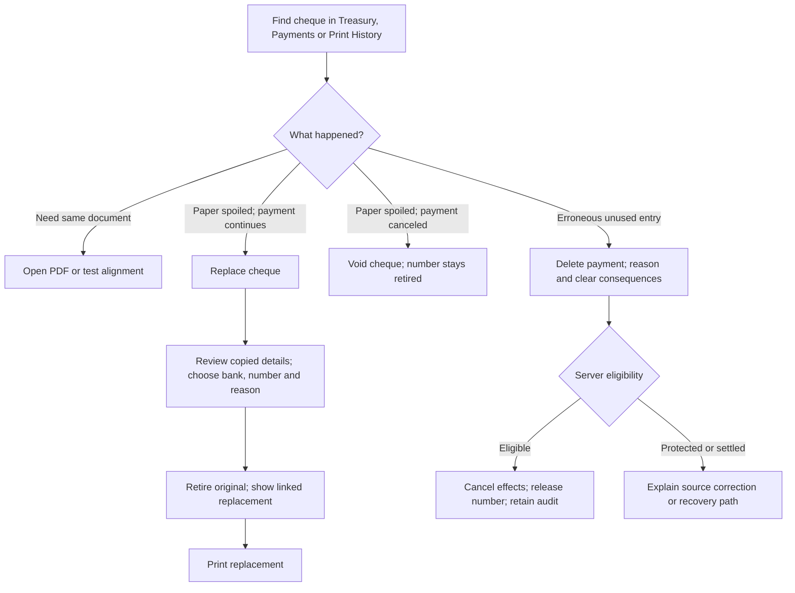

# Cheque replacement and deletion: independent design review

Planning only, 2026-10-19. No application code or financial records changed. Reviewed with the root agent; this document is an input to the durable handoff.

## Recommendation

Keep the existing cheque register and physical-instrument replacement links. Extend the existing Replace action rather than inventing a new payment engine or a separate spoilage wizard. Make business deletion explicit and distinct from retaining a retired physical cheque. Use one reusable replacement dialog across Treasury, Payments, and Print History, with eligibility determined by the server.

For supplier cheques retain a new `ap_payment` per replacement instrument, as the schema explicitly models it. Keep historical allocations but exclude retired/deleted payments from active scheduled amounts. For expense-backed cheques reuse the original expense across replacement cheque records: replacement changes the paper/bank instrument, not the incurred expense. This avoids the current duplicate expense bug and preserves its metadata and external links. Validate any custody/remittance linkage before offering actions; reusing an expense is not permission to bypass its source guards.

## Verified implementation findings

- `packages/api/services/apPdcService.js:539`: Replace only accepts stored BOUNCED/STALE, while the UI offers Replace based on calculated stale maturity. A naturally aged ISSUED cheque can be offered an operation that the backend rejects.
- Replacement makes a new AP payment, copies allocations without checking whether bills remain valid/outstanding, overwrites notes/reference, and loses the original payment_date input by taking its default. Replacement copies template_id even when changing bank.
- Expense replacement creates a second expense and does not retire the first. This can double count the expense. Reusing the original expense is less work than cloning every supported metadata field, voiding the original, and trying to transfer external references.
- Existing replacement UI asks for a blank required date, offers no bank selector, and has an optional free-text reason. The endpoint already accepts an optional new bank account.
- `packages/api/routes/chequeRoutes.js:593`: Print History Delete hides the shared cheque record, leaving its payment active and its number reserved. No confirmation or business impact summary is shown.
- `packages/api/services/apPdcService.js:270`: Clearance does not test lifecycle status or deletion before clearing. It also manually writes each bill's amount_paid from the current payment's allocation rather than the aggregate of all settled payments. Terminal-state guards and aggregate settlement correctness are prerequisites for a robust new deletion status.
- PDF generation checks VOID/REPLACED but not hidden/deleted state. It records a PRINTED event for AP cheques after PDF generation; this is not physical printing evidence. Expense and standalone records receive no equivalent event through that code path.
- Standalone `/cheques/records` rows contain only payee/amount/date/memo/template. They do not identify a bank account, cheque number, AP payment, or expense. Do not claim to release numbers or delete payments for these print-only entries.

## Smallest coherent domain model

| Action | Active payment/obligation effect | Original number | New instrument |
|---|---|---|---|
| Replace cheque | Obligation continues once | Permanently reserved; original REPLACED | Linked new ISSUED cheque |
| Void cheque | Cancel active payment commitment | Permanently reserved; VOID | None |
| Delete payment | Remove erroneous active entry and its financial effects | Reusable only when explicitly classified erroneous/unused | None |
| Remove print entry | Remove standalone print-only record | No bank/number was recorded | None |

`DELETED` is a reasonable minimal explicit business status if its exclusive meaning is erroneous-entry deletion and number release. A partial unique index excluding only DELETED is then simpler than an orthogonal number release marker. Do not exclude `is_deleted=true` generally: legacy hidden ISSUED entries may represent actual spoiled/issued instruments and must remain reserved until reviewed. Require a deletion event containing prior status, number, bank, reason, actor, and released-number fact. All operations must recognize DELETED as terminal. Existing `is_deleted` can remain a visibility implementation detail; do not automatically map historical hidden rows to business deletion.

Only the current active replacement-chain leaf can be deleted. VOID/REPLACED ancestors never release their numbers. Deleting B in A → B never silently reactivates A. Keep the historical link to deleted B, cancel the active payment commitment, and allow a newly recorded payment if needed. A later correction tool may amend a typo without canceling an obligation, but avoid an implicit undo-replacement operation in this change.

## Clean replacement dialog

```text
Replace cheque #313083
BJ AUTO PARTS SUPPLY                         ₱12,150.00
Bills 10431 ₱3,650 + 10374 ₱8,500             [View details]

Bank account       [Security Bank account ▼]  (original selected)
New cheque number  [suggested next number    ] (editable, required)
Cheque date        original date               [Change date]
Reason             [Printing issue ▼        ]
[Optional detail; required when Other]

Cheque #313083 will remain in history and cannot be used again.
The replacement keeps the same payment details and bill allocations.

[Cancel]                                      [Replace cheque]
```

Reason options: Printing issue, Damaged cheque, Stale cheque, Bounced cheque, Other. Printing issue groups jams and misalignment; optional notes provide detail. Other requires a note. Reason is audit metadata, not a second lifecycle status. Preserve payee, amount, purpose, memo, references, supplier/employee/category and exact bill splits. Date defaults to original and displays a Change date control; warn and require a usable date for a stale replacement. Select bank ACCOUNT, not only bank name: cheque number uniqueness belongs to the account. Only active same-currency accounts are eligible. Currency cannot change implicitly while copying a nominal amount. Resolve the new account's default layout; missing layout does not lose the replacement, but show a clear Select print template action before printing.

The suggested number is a convenience, never a reservation until the transaction succeeds. Validate availability again on submit, preserve leading zeros, and refresh the suggestion when bank account changes. Number reuse requires explicit deletion; a suggestion must not silently fill gaps from VOID/REPLACED records. New instrument audit uses the replacement actor/time; original payment and expense economic metadata remain intact.

After success show the new record with `Replacement for #313083`, plus `Print replacement` and `View history`. Do not automatically print or auto-create another payment when PDF generation fails. Retry Print always uses the newly issued record. Use separate PDF_GENERATED and TEST_PDF_GENERATED events and clear user-facing labels; neither claims successful physical printing.

## Clean deletion dialog

Use `Delete payment` in the row More menu, separated from ordinary actions. Show payee, amount, bank account, number, affected bills, and reason. State `This removes the payment and makes cheque #313084 available again. It does not mark the cheque spoiled.` An explicit consequence statement and required reason are enough for routine eligible erroneous entries; do not add a mandatory checkbox, typed-number exercise, or second confirmation. Eligibility still requires no valid physical cheque remains outstanding; if a dependency makes that uncertain, explain the blocker/recovery path. Printed/PDF-generated alone is insufficient to infer physical use. If the sheet was jammed/damaged, direct users to Replace or Void instead.

For a replacement leaf explicitly state `Cheque #313083 remains retired. These bills will no longer have an active payment.` Keep Cancel focused initially, return focus to the originating row/menu, trap focus in the existing modal, and expose inline errors and pending state. Never use a generic `Are you sure?` dialog that omits number-release consequences.

## Scenario and eligibility matrix

| Scenario | Recommended behavior |
|---|---|
| PDF generation fails before printing | Retry PDF on same instrument; no replacement required |
| Successful PDF, misaligned physical print/paper jam | Replace from ISSUED/HELD; permanently retire original |
| PDF generated but blank cheque stock never used; payment was erroneous | Delete with unused/erroneous confirmation; release number |
| Spoiled cheque, payment abandoned | Void; retain number; cancel active commitment |
| Cheque manually handed out or already deposited | Allow replacement only after explicit confirmation it is recovered/canceled or handled through stop-payment process; app status alone cannot prevent encashment |
| Bounced | Keep bill reservation until explicit replacement/cancellation; replacement remains linked and supplier-hold rules apply |
| Stale by date while stored ISSUED | Server computes eligibility consistently with UI; editable replacement date |
| Already CLEARED | No simple Replace/Delete; use supported financial correction/reversal first |
| Cash/custody/remittance linked | Explain exact dependency and provide correction route; never bypass database guards |
| Goods-receipt freight or another source owns the payment | Block generic deletion and route to source correction; do not rely on ON DELETE SET NULL to detach accounting invisibly |
| Bill paid elsewhere, voided, reduced or supplier changed since issue | Reject exact-copy replacement with affected bill explanation; no silent rebalance or partial replacement |
| Multiple pending payments to same bill | Available-to-schedule subtracts settled plus active scheduled amounts; replacement excludes its own old leaf |
| Multiple partial cleared payments | Aggregate all settled allocations; clearing one cheque cannot overwrite previous amount_paid |
| Same number on same account | Reject unless its prior entry has explicitly DELETED/released status |
| Same number on another account | Allowed if account/number pair is available |
| New bank missing print template | Save valid replacement and direct to template selection; never reuse another bank's layout silently |
| New bank inactive/different currency | Reject with a specific error; currency conversion is outside exact-copy replacement |
| Two users replace same original | Row lock and successor uniqueness; one succeeds, other receives current replacement link |
| Response lost, user retries Replace | Idempotency token returns original result; no extra AP payment/expense/cheque |
| Replacement itself spoiled | Replace current leaf again; retain full chain and single active commitment |
| Delete current replacement | Release that leaf only; no ancestor revival; bills no longer scheduled by it |
| Remove historical print-only row | Remove print entry; no fabricated financial effects or number release |
| Legacy hidden instrument | Searchable recovered view with actual status and links; manual classification before any number release |

## Atomicity and consistency

One transaction locks the original cheque, linked payment/expense and affected bills; validates source/dependency state; checks replacement input; creates the instrument and AP row if needed; marks old instrument/payment appropriately; writes both links and mandatory audit; commits once. Failure leaves the original untouched. Do not swallow mandatory replacement/deletion audit failures. Audit printing is a separate event and cannot decide whether an instrument is financially valid.

Centralize eligible actions and explanatory blockers, so Treasury, Payments and Print History show the same Replace/Void/Delete meaning and the server enforces it. Recompute actions after concurrent updates. A duplicate-number error should offer `View existing cheque` even when that record is retired or legacy-hidden.

Pending and settled amounts must be separate: `Outstanding` remains the actual unsettled liability, `Scheduled` includes currently active unpaid instruments, and `Available to schedule` is outstanding minus scheduled. REPLACED/VOID/DELETED do not reserve bill amounts, although VOID/REPLACED permanently reserve their physical cheque numbers.

## Source guidance

### Minimal journey



### Existing UI tokens and interaction

Reuse current `Modal`, `LABEL_CLASS`, `TEXT_INPUT_CLASS` and existing button components/classes. Keep summary/secondary content in existing `text-gray-600 dark:text-slate-300`, borders `border-gray-200 dark:border-slate-700`, and panel surfaces `bg-white dark:bg-slate-800`; use semantic warning/danger tokens already present in Treasury. Use a single-column form at narrow widths, `space-y-4`, and normal pending text rather than introducing animations. No mobile-source work is proposed.

Keep visible input labels, text status labels in addition to color, field-associated inline errors, and keyboard focus containment/return. Focus Cancel/Keep payment for destructive confirmation; Escape closes before submission, and the submit button is disabled while pending. Announce completion and errors through the existing accessible feedback pattern; focus the current replacement row or a stable list control after deletion. Optional date control must announce whether the date field is expanded. Respect reduced-motion settings if existing components animate.

The accessible confirmation pattern should follow [W3C's modal dialog guidance](https://www.w3.org/WAI/ARIA/apg/patterns/dialog-modal/): constrain focus, restore it on closing, and consider initially focusing the least destructive action for financial/deletion confirmation. Existing Headless UI/Modal patterns and semantic tokens should be reused; this workflow does not need new fonts, glass effects, animation systems, a new wizard, or extra printing confirmation on every PDF.

## Open product policy decisions

- Whether deposited/outstanding replacement requires an explicit recovered/stop-payment acknowledgement in the first release or is routed to a guided correction operation. Do not permit silently replacing an outstanding physical cheque.
- Whether `Delete payment` includes direct cash/transfer payments in this scope. Settled direct payments require reversals and custody corrections; cheque-only erroneous entry deletion is a narrower safe first capability.
- How source-linked agency remittances should expose bank-instrument changes. Existing correction rules remain binding.
- Whether exact-copy bill allocation conflicts are resolved by Cancel and Record new payment, or a later explicit adjustment feature. Do not silently change requested allocations.
