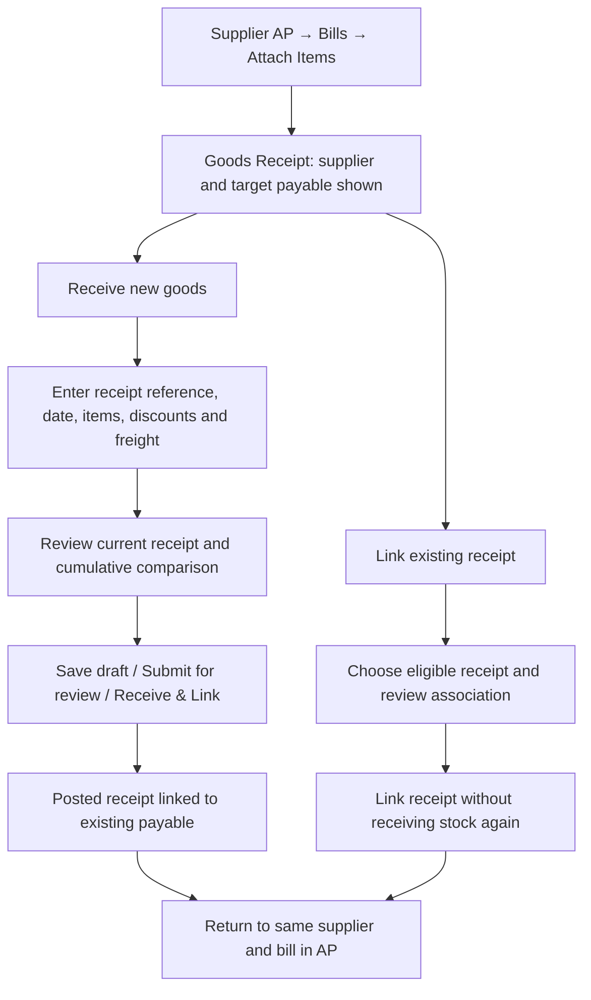

# Supplier payable → goods receipt: workflow review

Date: 2026-10-20 (Asia/Manila)
Status: Design proposal based on source review; no application changes or runtime verification.

## Recommendation

Make **Attach Items** open the existing Goods Receipt page in **Receive against payable** mode. Carry the selected bill ID and supplier ID, prefill and lock the supplier, and keep the target payable visible throughout entry, drafting, review, and posting.

Use the full receiving experience for quantities, discounts, rejected goods, freight, and costing. Opening the page alone must not create a receipt, move stock, or change the payable.

Keep **Link existing receipt** as a separate secondary action on that page. It associates an eligible receipt already recorded in the system; it must never post inventory again.

## Observed current behavior

- `SupplierDetailDrawer.jsx` opens `AttachItemsModal.jsx` from the bill's Attach Items action.
- That modal immediately posts `/goods-receipts` with `supplier_id`, `bill_id`, and simple quantity/cost lines. It does not offer the full receipt form.
- `GoodsReceiptPage.jsx` already supports page-state navigation for expense prefills and opening staged receipts, but its `buildPayload` does not include the target payable ID. Its local draft uses a shared `goods-receipt` key.
- The API's direct receiving path accepts `bill_id` and checks that it belongs to the supplier and is not Paid. Draft header parsing also accepts `bill_id`; the staged post path passes it to the shared posting service. Validation needs consistent review across direct posting, draft edits, and staged posting.
- `grnPostingService.js` uses a supplied bill ID to avoid creating another goods payable. Carrier freight can still create separate carrier payables.
- Multiple receipts can refer to one bill. Existing bill-item variance uses raw quantity × cost; it does not provide the same net-of-discount/return comparison as the full costing view.
- The reviewed goods receipt routes do not expose a dedicated existing-receipt association action. Treat that as new behavior requiring backend design.

## Proposed journey



Draft and submission actions do not move stock. Only an authorized post does so. A confirmation of draft save or submission must say which stage completed.

## Page layout and wording

```text
← Back to Supplier Accounts Payable
Goods Receipt — Receive against payable

Supplier: METRO AUTO PARTS [fixed]
Payable: INV-00456       Bill total: ₱18,500
Bill date: …  Due: …    Status: …  Outstanding: …
This receipt will be linked to the payable shown above.

Receive new goods                  Link existing receipt

[Existing full Goods Receipt form]
Receipt date | Supplier document number | Same-supplier PO
Items | quantities | costs | discounts | rejected quantities
Freight and carrier details

Payable goods comparison
Bill total                               ₱18,500
Previously received goods                 ₱8,000
This receipt: net accepted goods           ₱6,000
Cumulative goods value                   ₱14,000
Difference to review                      ₱4,500

[Save Draft] [Submit for Review] [Receive & Link to Payable]
```

- Preserve **Attach Items** as the entry label initially; the page heading and final action explain the stock movement. A future label such as **Receive Goods** may be clearer, but is optional.
- Render only actions allowed by the user's existing create/submit/post permissions. AP management alone must not imply permission to post inventory.
- Use a compact context card (`rounded-lg border p-4`, existing light/dark tokens). Reuse existing form, costing, and freight components and primary button styles. No new visual system is needed.
- Keep the supplier read-only in this mode; explain that it comes from the selected payable. Filter POs to that supplier and reject mismatches on the server.
- Display bill number as context. Do not copy an automatically generated bill number into the physical supplier document reference. Receipt and bill dates can differ; ask for the actual receipt date using the existing date behavior.
- After posting, show the receipt number, linked bill, and result, then offer **Back to payable** and **View receipt**. Restore the supplier drawer, Bills tab, target bill, and useful list filters. Refresh receipt links and comparison values.

## Comparison rules

Compare the full original bill amount with cumulative **net accepted goods value** across posted, active receipts plus the current proposed receipt. Exclude drafts, cancelled/void receipts, and carrier freight; account consistently for discounts and returns using the shared costing logic.

Keep the outstanding payment balance separate: a partly paid ₱18,500 bill is still compared with ₱18,500 of goods, even if only ₱5,000 remains payable.

Use **Difference to review**, not a claim that goods are missing. Freight, services, timing, returns, or invoice errors may explain a difference. Show a contextual message and require review for an excess without silently changing the bill amount. Do not require an exact match for a partial delivery. Value equality alone cannot establish that every ordered item arrived.

Keep separate carrier liabilities visible in the posting summary. Linking the goods to an existing bill prevents a second goods payable; it does not eliminate legitimate new carrier charges.

## Existing receipt association

Offer candidates from the same supplier only. Show receipt number, physical reference, date, workflow status, net goods value, and existing payable association.

| Receipt condition | Proposed action |
|---|---|
| Already linked to this bill | Show Already linked; no duplicate operation |
| Draft or submitted receipt | Resume/review the staged receipt; linking is not a receipt posting |
| Posted, active, unlinked receipt | Allow only after verifying no other bill or ledger relationship represents its liability |
| Receipt linked to another bill | Show the existing bill; block simple reassignment |
| Void/cancelled receipt or other supplier | Ineligible |
| Historical backfill | Exclude from ordinary linking pending a separate reconciliation policy |

Normal posting often creates its own payable, so an already posted receipt may be ineligible for simple linking. Explain that the receipt already has a payable and provide a view action. Consolidation or correction of two payable records requires a separate explicit workflow that accounts for payments, ledger effects, and audit history.

Keep the existing model for the initial scope: multiple receipts per payable; one goods-payable association per receipt. Splitting one receipt across several goods payables needs a different allocation design.

## Drafts, errors, and safeguards

- Persist bill ID alongside supplier ID in server drafts and when reopening a submitted receipt. Revalidate eligibility immediately before posting.
- Keep local drafts scoped to the intended bill, with an explicit restore choice when another receiving session exists. Never silently replace a supplier's draft with an unrelated one.
- Preserve target context through refresh according to the application's navigation/persistence mechanisms. Restore authoritative bill information from the server; navigation payload labels are not authoritative.
- Recheck supplier, bill status, association, and permissions on the server. Explicitly decide permitted bill statuses rather than accepting every status except Paid; reject Void.
- Keep Paid blocked for the initial proposal, matching today's receiving restriction. Supporting prepaid goods would require a deliberate policy change, not an accidental relaxation.
- Prevent duplicate submission and handle retry/concurrent association safely. Reuse supplier-scoped document duplicate detection; retain the user's original reference text.
- If a physical document already exists, offer to view/resume that receipt rather than entering the goods again. Do not link automatically from a reference match.
- Preserve entered data on validation failure. Show an inline error and focus the relevant field; announce asynchronous results accessibly. Use text as well as color for status and variance.
- Review return and void behavior before enabling more associations: current receipt voiding and returns can affect the linked bill. Confirm behavior for manually created payables and multiple linked receipts, and audit actor/time/source/target for association changes.
- Keep historical backfill separate from ordinary receiving against an outstanding payable because backfill intentionally suppresses payable creation and has special inventory behavior.

## Review criteria for a future implementation

1. Attach Items opens the full receipt page with the correct supplier and bill visibly fixed.
2. Open/save/submit causes no stock movement or additional goods payable.
3. Posting a new receipt moves stock once and links to the original payable, preserving its amount and payment history.
4. Draft save, reopen, submit, review, and post retain the target association and enforce the same eligibility checks.
5. Partial deliveries accumulate correctly; discounts, returns, voids, and freight produce a consistent comparison.
6. Existing-receipt association changes no stock and creates no second liability; conflicting associations are blocked.
7. Return navigation restores the same supplier's bill with refreshed receipt details.
8. Permission failures, stale statuses, duplicates, retries, and competing receiving drafts do not lose data or change the wrong bill.

These are proposed acceptance criteria; no implementation or tests were run in this review.

## UX reference

The contextual review and explicit completion message follow the GOV.UK Design System's [check answers](https://design-system.service.gov.uk/patterns/check-answers/) and [confirmation page](https://design-system.service.gov.uk/patterns/confirmation-pages/) guidance. They inform the interaction pattern; the accounting behavior above is a project-specific proposal grounded in the reviewed source.

## Follow-up: supplier account as an entry point to shared workflows

User direction: reuse existing features and the same forms for the same purpose. Supplier A/P should expose receipt information and supplier payment actions, passing identifiable origin context rather than maintaining separate receiving or payment implementations.

### Supplier account surface

- Keep Bills, Payments, and Ledger; propose a Receipts view for this supplier's recorded goods receipts and their physical supplier document references. Existing bill-level receipt links remain useful.
- Show supplier document references alongside the internal bill and GRN identifiers; do not present these as interchangeable numbers. If a scanned supplier document is available through the existing document viewer, expose that viewer through the receipt details rather than building another document form.
- Supplier-level **Receive Goods** opens the shared Goods Receipt page with supplier context and no invented target bill. Matching/manual selection determines the payable when needed.
- Bill-level **Attach Items** opens that same page with supplier and exact target bill context.
- Supplier-level **Record Payment** opens the existing shared payment form with supplier fixed and the supplier's eligible bills loaded. Keep amount and method for deliberate entry.
- Bill-level **Pay This Bill** opens that same payment form with the target bill selected and its currently available payable amount suggested. Scope allocation to the selected bill unless the user explicitly expands it; do not silently use the form's current default automatic allocation across bills.

### Verified current payment foundation

`AccountsPayablePage.jsx` already mounts `RecordSupplierPaymentModal` and accepts `recordPaymentFor` supplier context through page state. The shared modal already accepts `presetSupplier`, fixes its display when supplied, loads that supplier's open bills, and handles available payment methods. Cheque selection uses the existing outbound issuance path; cash, bank transfer, and e-wallet methods use the settlement flow. This supersedes the older manual's cheque-only description.

`SupplierDetailDrawer.jsx` currently has no payment callback wired from A/P. Reusing the parent-owned payment modal is the natural extension. Bill-specific initial selection/allocation and source/return context still need implementation; they are not already supported by the supplier-only preset prop.

### Context and return behavior

Use one shared navigation contract carrying source page, supplier ID, optional bill ID/receipt ID, intended action, and return view (supplier, active tab, focused row, relevant filters). Labels and balances are fetched from authoritative records. Show a human-readable origin such as **From Accounts Payable → Metro Auto Parts → BILL-…**, with **Back to supplier account**.

Completion/cancellation restores the source supplier account and tab. Completion refreshes bills, linked receipts, payments, scheduled amounts, and balances as appropriate. Cheque issuance must preserve its existing lifecycle: issued/scheduled is distinct from settled, and bill paid balances move when the cheque clears. Existing permissions, holds, validation, allocation, bank-account and cheque-number rules stay in the shared workflow.

Status: conceptual refinement only. No UI, navigation, database, or payment behavior changed.
